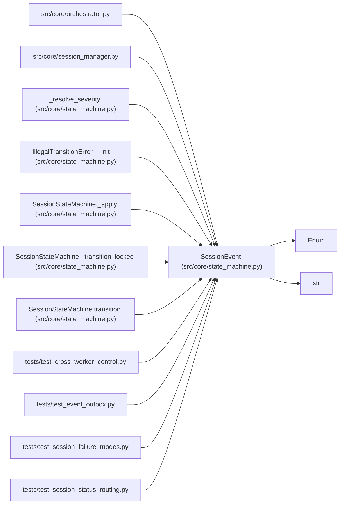

# SessionEvent

**Location:** `src/core/state_machine.py:68`
**Kind:** Enum
**Bases:** `str`, `Enum`
**Module:** [state_machine](../modules/state_machine.md)

## Description

Events that drive session state transitions (ARC-011 §4.1).

## Attributes

| Name | Declared value | Description |
|------|-------|-------------|
| `START` | `'start'` | — |
| `PAUSE` | `'pause'` | — |
| `RESUME` | `'resume'` | — |
| `STOP_REQUESTED` | `'stop_requested'` | — |
| `FINALIZE_STOP` | `'finalize_stop'` | — |
| `COMPLETE` | `'complete'` | — |
| `TIMEOUT` | `'timeout'` | — |
| `HARD_TIMEOUT` | `'hard_timeout'` | — |
| `FAIL` | `'fail'` | — |
| `RESTART_RECOVER` | `'restart_recover'` | — |

## Methods

*No public methods. Inherits from base classes.*

## Relationships

<!-- Auto-generated relationship summary. Do not edit by hand. -->

### Summary

| Module | Methods | Attributes |
|---|---:|---|
| [state_machine](../modules/state_machine.md) | 0 | `COMPLETE`, `FAIL`, `FINALIZE_STOP`, `HARD_TIMEOUT`, `PAUSE`, `RESTART_RECOVER`, `RESUME`, `START`, `STOP_REQUESTED`, `TIMEOUT` |

### Structure

| Kind | Entity | Module |
|---|---|---|
| Base | `Enum` | — |
| Base | `str` | — |

### References

| Reference | Kind | Source | Call sites |
|---|---|---|---:|
| `orchestrator` | import | [orchestrator](../modules/orchestrator.md) | — |
| `session_manager` | import | [session_manager](../modules/session_manager.md) | — |
| `_resolve_severity` | type_reference | [state_machine](../modules/state_machine.md) | — |
| `IllegalTransitionError.__init__` | type_reference | [state_machine](../modules/state_machine.md) | — |
| `SessionStateMachine._apply` | type_reference | [state_machine](../modules/state_machine.md) | — |
| `SessionStateMachine._transition_locked` | type_reference | [state_machine](../modules/state_machine.md) | — |
| `SessionStateMachine.transition` | call | [state_machine](../modules/state_machine.md) | 1 |
| `SessionStateMachine.transition` | type_reference | [state_machine](../modules/state_machine.md) | — |
| `test_cross_worker_control` | import | [test_cross_worker_control](../modules/test_cross_worker_control.md) | — |
| `test_event_outbox` | import | [test_event_outbox](../modules/test_event_outbox.md) | — |
| `test_session_failure_modes` | import | [test_session_failure_modes](../modules/test_session_failure_modes.md) | — |
| `test_session_status_routing` | import | [test_session_status_routing](../modules/test_session_status_routing.md) | — |

> References: showing 12 of 17 logical references; 5 omitted by the 12-row generated summary limit.
