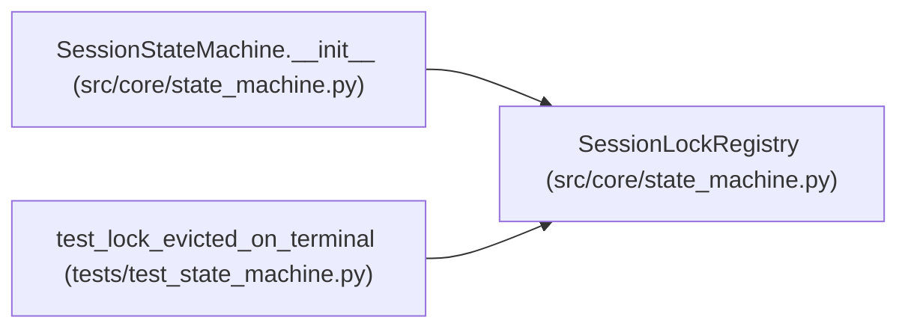

# SessionLockRegistry

**Location:** `src/core/state_machine.py:292`
**Kind:** Class
**Bases:** —
**Module:** [state_machine](../modules/state_machine.md)

## Description

Per-session ``asyncio.Lock`` registry for ``transition()``.

Lazily creates one lock per ``research_id`` so the
read-decide-write-audit-broadcast critical section serializes per session
without blocking unrelated sessions. Locks for sessions that reach a
terminal state are evicted by ``SessionStateMachine.transition`` once the
lock is released: a terminal session admits no state-changing transition
(the only post-terminal change is the idempotent ``stopped -> timed_out``
re-classify), so the lock is dead and a fresh one is created if activity
ever resumes. ARC-011 §7.1.

## Attributes

*No annotated attributes found.*

## Methods

| Method | Signature | Decorators | Description |
|--------|-----------|------------|-------------|
| `__init__` | `() -> None` | — | — |
| `for_session` | *(async)* `(research_id: str) -> AsyncIterator[None]` | `@asynccontextmanager` | Acquire the per-session lock, creating it on first use. |
| `evict` | `(research_id: str) -> None` | — | Drop the per-session lock (called after a terminal transition). |
| `size` | `() -> int` | `@property` | — |

## Relationships

<!-- Auto-generated relationship summary. Do not edit by hand. -->

### Summary

| Module | Methods | Attributes |
|---|---:|---|
| [state_machine](../modules/state_machine.md) | 4 | — |

### References

| Reference | Kind | Source | Call sites |
|---|---|---|---:|
| `SessionStateMachine.__init__` | call | [state_machine](../modules/state_machine.md) | 1 |
| `SessionStateMachine.__init__` | type_reference | [state_machine](../modules/state_machine.md) | — |
| `test_lock_evicted_on_terminal` | call | [test_state_machine](../modules/test_state_machine.md) | 1 |
