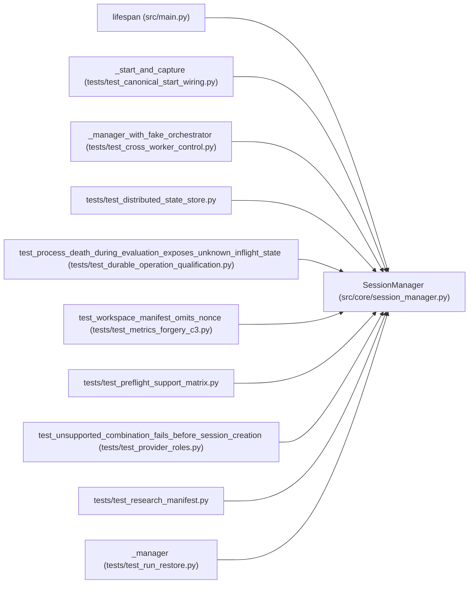

# SessionManager

**Location:** `src/core/session_manager.py:104`
**Kind:** Class
**Bases:** —
**Module:** [session_manager](../modules/session_manager.md)

## Description

Manages the lifecycle of research sessions as asyncio tasks.

## Attributes

*No annotated attributes found.*

## Methods

| Method | Signature | Decorators | Description |
|--------|-----------|------------|-------------|
| `__init__` | `(store: StateStore, *, state_machine: Optional[SessionStateMachine] = None) -> None` | — | — |
| `active_count` | `() -> int` | `@property` | — |
| `is_running` | `(research_id: str) -> bool` | — | — |
| `_attach_done_callback` | `(task: asyncio.Task, *, research_id: Optional[str] = None, pipeline_id: Optional[str] = None) -> None` | — | Log + persist + broadcast any uncaught exception escaping a |
| `_finalize_crashed_session` | *(async)* `(research_id: str, exc: BaseException) -> None` | — | Persist a terminal ``failed`` state for a crashed background task. |
| `_reserve_budget` | *(async)* `(config: ResearchConfig) -> None` | — | Reserve bounded spend before work starts. |
| `_reconcile_budget` | *(async)* `(research_id: str) -> None` | — | Reconcile the reservation against recorded spend at the end. |
| `_reserve_work` | *(async)* `(config: 'ResearchConfig') -> None` | — | Reserve logical work and a global capacity slot atomically. |
| `_commit_work` | *(async)* `(research_id: str) -> None` | — | — |
| `_release_work` | *(async)* `(research_id: str) -> None` | — | — |
| `_release_uncommitted_work` | *(async)* `() -> None` | — | Release reservations whose attempt failed before the session row. |
| `_ensure_lease_renewal` | `() -> None` | — | — |
| `_lease_renewal_loop` | *(async)* `() -> None` | — | — |
| `recover_orphaned_sessions` | *(async)* `() -> Dict[str, int]` | — | Classify sessions left active by a previous service process. |
| `_classify_orphaned_session` | *(async)* `(session: Dict[str, Any]) -> Dict[str, Any]` | — | — |
| `start_session` | *(async)* `(**kwargs: Any) -> Dict` | — | — |
| `_start_session_unlocked` | *(async)* `(*, instrument: str, timeframe: str, model_type: str, tag: Optional[str] = None, quick_mode: Optional[bool] = None, max_iterations: Optional[int] = None, max_budget_usd: Optional[float] = None, timeout_minutes: Optional[int] = None, focus_hint: Optional[str] = None, manifest: Optional[Dict[str, Any]] = None, skill_id: Optional[str] = None, skill_params: Optional[Dict[str, Any]] = None, subject_id: Optional[str] = None, variant: Optional[str] = None) -> Dict` | — | Start a new research session. Returns the created session dict. |
| `_run_and_cleanup` | *(async)* `(research_id: str, config: ResearchConfig) -> None` | — | Wrapper that ensures cleanup after the orchestrator finishes. |
| `_validate_session_skill` | `(config: ResearchConfig) -> None` | `@staticmethod` | Validate the session's skill runtime before anything is persisted. |
| `_run_skill_bootstrap` | *(async)* `(config: ResearchConfig) -> None` | — | Render the session workspace with the skill's ``bootstrap.py`` |
| `_run_preflight` | *(async)* `(config: ResearchConfig) -> Dict[str, Any]` | — | Run the skill's declared dependency checks and raise before any |
| `_run_local_file_preflight` | *(async)* `(config: ResearchConfig, *, stage: str) -> None` | — | Run the declared local_file prerequisites for one stage, failing |
| `_skill_preflight_targets` | `(skill_id: str) -> list[ServicePreflightTarget]` | `@staticmethod` | Map the skill manifest's ``preflight`` section to check targets. |
| `_archive_stale_workspace` | *(async)* `(workspace_path: str) -> None` | — | Move an existing model workspace to a timestamped archive directory. |
| `_build_manifest_payload` | `(config: ResearchConfig, *, overrides: Optional[Dict[str, Any]] = None, parent_snapshot: Optional[Dict[str, Any]] = None, pinned_run_spec_sections: Optional[Mapping[str, Any]] = None) -> tuple[str, str, str]` | — | — |
| `_capture_parent_snapshot` | `(parent_workspace: str) -> Optional[Dict[str, Any]]` | — | The retained parent reference: a bundle of the parent's candidate |
| `_persist_secret_refs` | *(async)* `(research_id: str, manifest_json: str) -> None` | — | Persist the run spec's secret *references* — never any value. |
| `_manifest_integrity` | `(parent: Mapping[str, Any]) -> Dict[str, Any]` | `@staticmethod`, `@staticmethod` | Whether the parent's manifest claims a pinned spec it cannot read. |
| `_parent_run_spec` | `(parent: Mapping[str, Any]) -> Tuple[Dict[str, Any], Dict[str, Any], Dict[str, Any]]` | `@staticmethod` | The parent's pinned resolved spec for continuation. |
| `_rebind_secret_params` | `(params: Dict[str, Any], secret_refs: Mapping[str, Any]) -> None` | `@staticmethod` | Re-bind secret parameters from their named environment variables. |
| `_installed_skill_pin` | `(skill_id: str) -> Tuple[Optional[str], Optional[str]]` | `@staticmethod` | The currently installed skill version and manifest digest. |
| `_check_skill_pin` | `(*, skill_id: str, run_spec: Mapping[str, Any], allow_skill_drift: bool) -> None` | — | Refuse to silently re-resolve a pinned run against a new skill. |
| `inspect_run_spec` | *(async)* `(research_id: str) -> Dict[str, Any]` | — | Inspect one run's immutable resolved spec and provenance. |
| `_write_manifest` | *(async)* `(config: ResearchConfig, manifest_json: str) -> str` | — | — |
| `continue_session` | *(async)* `(parent_id: str, *, allow_skill_drift: bool = False, recovery_kind: str = 'continuation', **kwargs: Any) -> Dict` | — | — |
| `_continue_session_unlocked` | *(async)* `(parent_id: str, *, recovery_kind: str = 'continuation', max_iterations: Optional[int] = None, max_budget_usd: Optional[float] = None, timeout_minutes: Optional[int] = None, focus_hint: Optional[str] = None, allow_skill_drift: bool = False) -> Dict` | — | ML-62: Continue a timed-out session as a new chained session. |
| `resume_interrupted_session` | *(async)* `(parent_id: str, *, reason: str, allow_interrupted: bool = False, max_iterations: Optional[int] = None, max_budget_usd: Optional[float] = None, timeout_minutes: Optional[int] = None, focus_hint: Optional[str] = None) -> Dict` | — | Explicit operator-controlled continuation for restart recovery. |
| `stop_session` | *(async)* `(research_id: str) -> bool` | — | Request a graceful stop for a running session. |
| `_drain_or_cancel_task` | *(async)* `(task: asyncio.Task, *, label: str, active_dict: Dict[str, Any], active_key: str, grace_s: float = 5.0) -> None` | — | Wait briefly for graceful stop, then cancel and free the active slot. |
| `_workspace_path_from_kwargs` | `(kwargs: Dict[str, Any]) -> Optional[str]` | `@staticmethod` | — |
| `_cleanup_failed_start_workspace` | *(async)* `(workspace_path: str) -> None` | — | — |
| `pause_session` | *(async)* `(research_id: str) -> bool` | — | — |
| `resume_session` | *(async)* `(research_id: str) -> bool` | — | — |
| `shutdown` | *(async)* `() -> None` | — | Gracefully cancel all active sessions and pipelines. |

## Relationships

<!-- Auto-generated relationship summary. Do not edit by hand. -->

### Summary

| Module | Methods | Attributes |
|---|---:|---|
| [session_manager](../modules/session_manager.md) | 44 | — |

### References

| Reference | Kind | Source | Call sites |
|---|---|---|---:|
| `lifespan` | call | [src_main](../modules/src_main.md) | 1 |
| `_start_and_capture` | call | [test_canonical_start_wiring](../modules/test_canonical_start_wiring.md) | 1 |
| `_manager_with_fake_orchestrator` | call | [test_cross_worker_control](../modules/test_cross_worker_control.md) | 1 |
| `_manager_with_fake_orchestrator` | type_reference | [test_cross_worker_control](../modules/test_cross_worker_control.md) | — |
| `test_distributed_state_store` | import | [test_distributed_state_store](../modules/test_distributed_state_store.md) | — |
| `test_process_death_during_evaluation_exposes_unknown_inflight_state` | call | [test_durable_operation_qualification](../modules/test_durable_operation_qualification.md) | 1 |
| `test_workspace_manifest_omits_nonce` | call | [test_metrics_forgery_c3](../modules/test_metrics_forgery_c3.md) | 1 |
| `test_preflight_support_matrix` | import | [test_preflight_support_matrix](../modules/test_preflight_support_matrix.md) | — |
| `test_unsupported_combination_fails_before_session_creation` | call | [test_provider_roles](../modules/test_provider_roles.md) | 1 |
| `test_research_manifest` | import | [test_research_manifest](../modules/test_research_manifest.md) | — |
| `_manager` | call | [test_run_restore](../modules/test_run_restore.md) | 1 |
| `_manager` | type_reference | [test_run_restore](../modules/test_run_restore.md) | — |

> References: showing 12 of 31 logical references; 19 omitted by the 12-row generated summary limit.
