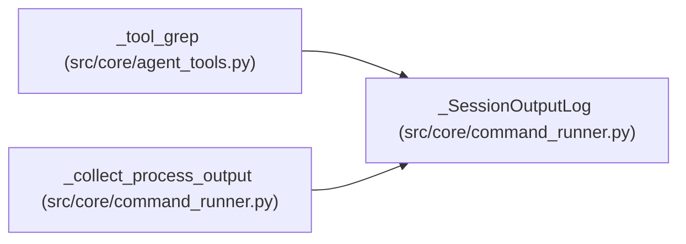

# _SessionOutputLog

**Location:** `src/core/command_runner.py:73`
**Kind:** Class
**Bases:** —
**Module:** [command_runner](../modules/command_runner.md)

## Description

Append child output under a shared session logs byte quota.

Quota exhaustion stops disk writes, NOT pipe draining or callbacks. Never
delete existing session files to reclaim space. Directory flock serializes
cooperating writers across worker threads/processes; no global session map
is retained. Other writers outside this helper do not participate.

>>> import tempfile
>>> with tempfile.TemporaryDirectory() as workspace:
...     first = _SessionOutputLog(workspace, quota_bytes=10)
...     second = _SessionOutputLog(workspace, quota_bytes=10)
...     first.write("abcde")
...     second.write("1234567890")
...     assert second.truncated
...     assert sum(p.stat().st_size for p in Path(workspace, "logs").iterdir()) == 10
...     first.close()
...     second.close()

## Attributes

*No annotated attributes found.*

## Methods

| Method | Signature | Decorators | Description |
|--------|-----------|------------|-------------|
| `__init__` | `(workspace: str, quota_bytes: int = _SESSION_LOG_QUOTA_BYTES)` | — | — |
| `_used_bytes` | `(directory_fd: int, depth: int = 0) -> int` | — | — |
| `write` | `(text: str) -> None` | — | — |
| `close` | `() -> None` | — | — |

## Relationships

<!-- Auto-generated relationship summary. Do not edit by hand. -->

### Summary

| Module | Methods | Attributes |
|---|---:|---|
| [command_runner](../modules/command_runner.md) | 4 | — |

### References

| Reference | Kind | Source | Call sites |
|---|---|---|---:|
| `_tool_grep` | call | [agent_tools](../modules/agent_tools.md) | 1 |
| `_collect_process_output` | call | [command_runner](../modules/command_runner.md) | 1 |
| `_collect_process_output` | type_reference | [command_runner](../modules/command_runner.md) | — |
