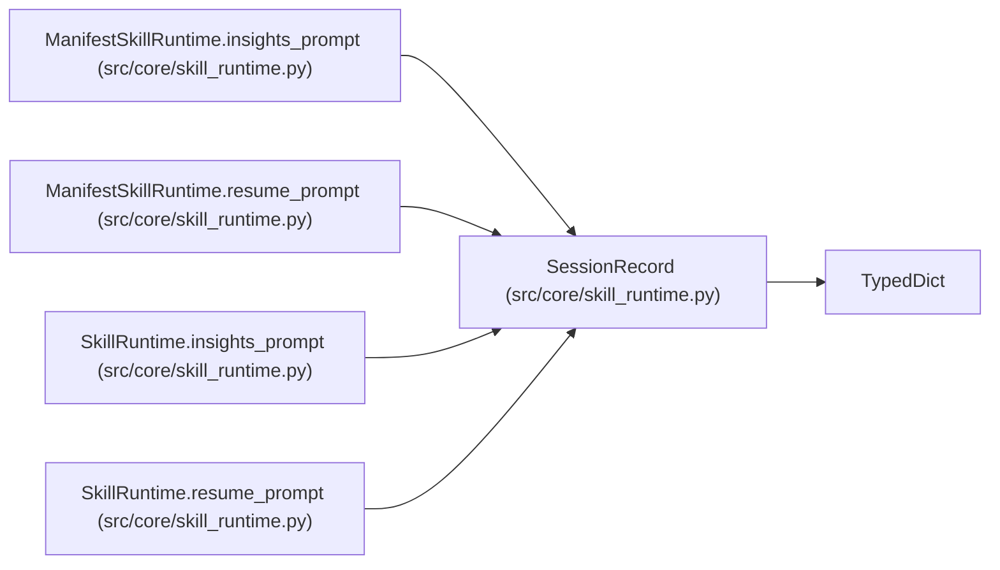

# SessionRecord

**Location:** `src/core/skill_runtime.py:82`
**Kind:** Class
**Bases:** `TypedDict`
**Module:** [skill_runtime](../modules/skill_runtime.md)

## Description

Alias over the session dict ``StateStore.get_session`` returns. Keys
mirror the ``research_sessions`` row (research_id, instrument, timeframe,
model_type, tag, status, ...). ``total=False`` — callers read via .get().

## Attributes

| Name | Type | Presence | Description |
|------|------|----------|-------------|
| `research_id` | `str` | *optional* | — |
| `instrument` | `str` | *optional* | — |
| `timeframe` | `str` | *optional* | — |
| `model_type` | `str` | *optional* | — |
| `tag` | `str` | *optional* | — |
| `status` | `str` | *optional* | — |

## Methods

*No public methods. Inherits from base classes.*

## Relationships

<!-- Auto-generated relationship summary. Do not edit by hand. -->

### Summary

| Module | Methods | Attributes |
|---|---:|---|
| [skill_runtime](../modules/skill_runtime.md) | 0 | `instrument`, `model_type`, `research_id`, `status`, `tag`, `timeframe` |

### Structure

| Kind | Entity | Module |
|---|---|---|
| Base | `TypedDict` | — |

### References

| Reference | Kind | Source | Call sites |
|---|---|---|---:|
| `ManifestSkillRuntime.insights_prompt` | type_reference | [skill_runtime](../modules/skill_runtime.md) | — |
| `ManifestSkillRuntime.resume_prompt` | type_reference | [skill_runtime](../modules/skill_runtime.md) | — |
| `SkillRuntime.insights_prompt` | type_reference | [skill_runtime](../modules/skill_runtime.md) | — |
| `SkillRuntime.resume_prompt` | type_reference | [skill_runtime](../modules/skill_runtime.md) | — |
