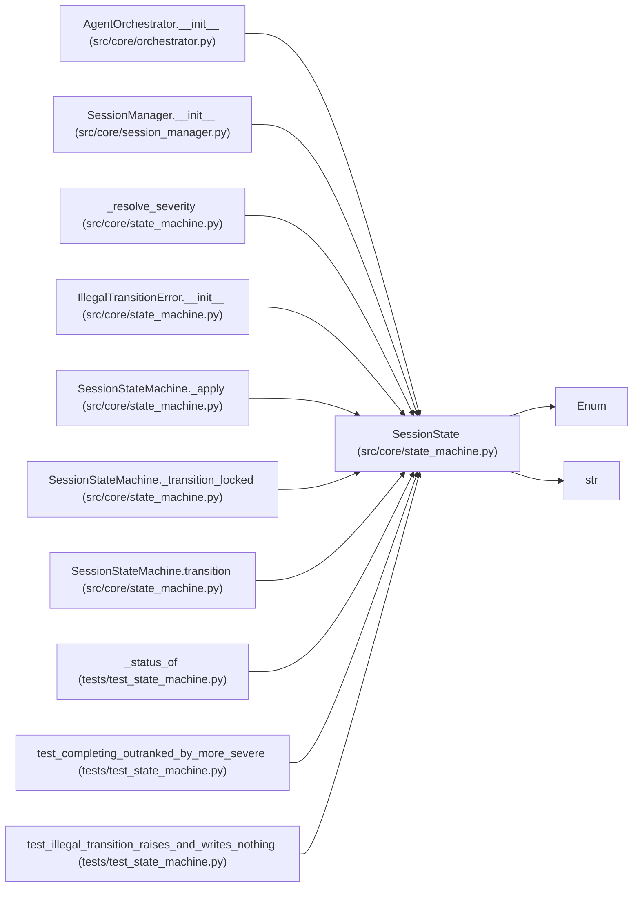

# SessionState

**Location:** `src/core/state_machine.py:44`
**Kind:** Enum
**Bases:** `str`, `Enum`
**Module:** [state_machine](../modules/state_machine.md)

## Description

The 13 session lifecycle states (ARC-011 §3).

## Attributes

| Name | Declared value | Description |
|------|-------|-------------|
| `PENDING` | `'pending'` | — |
| `RUNNING` | `'running'` | — |
| `PAUSED` | `'paused'` | — |
| `STOPPING` | `'stopping'` | — |
| `COMPLETING` | `'completing'` | — |
| `TIMING_OUT` | `'timing_out'` | — |
| `FAILING` | `'failing'` | — |
| `STOPPED` | `'stopped'` | — |
| `COMPLETED` | `'completed'` | — |
| `TIMED_OUT` | `'timed_out'` | — |
| `FAILED` | `'failed'` | — |
| `RESUMABLE` | `'resumable'` | — |
| `INTERRUPTED` | `'interrupted'` | — |

## Methods

*No public methods. Inherits from base classes.*

## Relationships

<!-- Auto-generated relationship summary. Do not edit by hand. -->

### Summary

| Module | Methods | Attributes |
|---|---:|---|
| [state_machine](../modules/state_machine.md) | 0 | `COMPLETED`, `COMPLETING`, `FAILED`, `FAILING`, `INTERRUPTED`, `PAUSED`, `PENDING`, `RESUMABLE`, `RUNNING`, `STOPPED`, `STOPPING`, `TIMED_OUT` |

### Structure

| Kind | Entity | Module |
|---|---|---|
| Base | `Enum` | — |
| Base | `str` | — |

### References

| Reference | Kind | Source | Call sites |
|---|---|---|---:|
| `AgentOrchestrator.__init__` | type_reference | [orchestrator](../modules/orchestrator.md) | — |
| `SessionManager.__init__` | type_reference | [session_manager](../modules/session_manager.md) | — |
| `_resolve_severity` | type_reference | [state_machine](../modules/state_machine.md) | — |
| `IllegalTransitionError.__init__` | type_reference | [state_machine](../modules/state_machine.md) | — |
| `SessionStateMachine._apply` | type_reference | [state_machine](../modules/state_machine.md) | — |
| `SessionStateMachine._transition_locked` | call | [state_machine](../modules/state_machine.md) | 1 |
| `SessionStateMachine._transition_locked` | type_reference | [state_machine](../modules/state_machine.md) | — |
| `SessionStateMachine.transition` | type_reference | [state_machine](../modules/state_machine.md) | — |
| `_status_of` | call | [test_state_machine](../modules/test_state_machine.md) | 1 |
| `_status_of` | type_reference | [test_state_machine](../modules/test_state_machine.md) | — |
| `test_completing_outranked_by_more_severe` | type_reference | [test_state_machine](../modules/test_state_machine.md) | — |
| `test_illegal_transition_raises_and_writes_nothing` | call | [test_state_machine](../modules/test_state_machine.md) | 2 |

> References: showing 12 of 16 logical references; 4 omitted by the 12-row generated summary limit.
