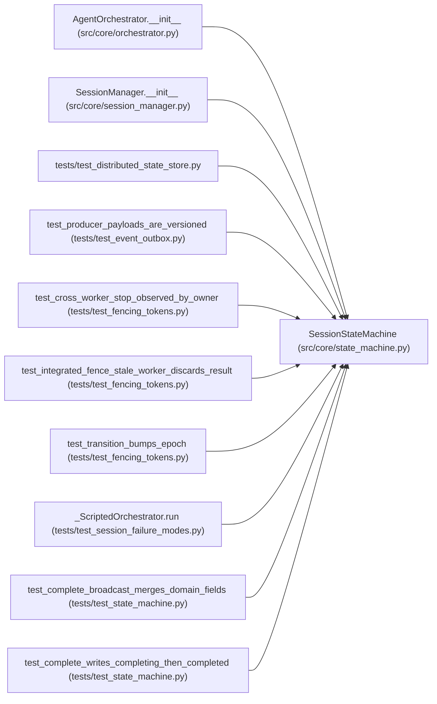

# SessionStateMachine

**Location:** `src/core/state_machine.py:329`
**Kind:** Class
**Bases:** —
**Module:** [state_machine](../modules/state_machine.md)

## Description

The single legal writer of ``research_sessions.status``.

Composes a ``StateStore`` (read / write status, emit audit) and an
``EventBroadcaster`` (lifecycle broadcasts). Both are injected rather than
imported as globals so the machine is unit-testable with a tmp SQLite DB
and a capturing broadcaster, and so the W8 race tests (P0-005) can drive it
deterministically.

## Attributes

*No annotated attributes found.*

## Methods

| Method | Signature | Decorators | Description |
|--------|-----------|------------|-------------|
| `__init__` | `(store: StateStore, broadcaster: EventBroadcaster, *, lock_registry: Optional[SessionLockRegistry] = None) -> None` | — | — |
| `transition` | *(async)* `(session_id: str, event: Union[SessionEvent, str], *, status_fields: Optional[Dict[str, Any]] = None, broadcast_fields: Optional[Dict[str, Any]] = None, actor_id: str = _SYSTEM_ACTOR, recovery_target: SessionState = SessionState.RESUMABLE) -> TransitionResult` | — | Drive one lifecycle transition under a per-session lock. |
| `_transition_locked` | *(async)* `(session_id: str, evt: SessionEvent, status_fields: Optional[Dict[str, Any]], broadcast_fields: Optional[Dict[str, Any]], actor_id: str, recovery_target: SessionState) -> TransitionResult` | — | — |
| `_apply` | *(async)* `(session_id: str, from_state: SessionState, evt: SessionEvent, spec: _TransitionSpec, status_fields: Optional[Dict[str, Any]], broadcast_fields: Optional[Dict[str, Any]], actor_id: str, *, severity_redirected: bool = False) -> TransitionResult` | — | Execute a resolved spec atomically under the caller's lock. |

## Relationships

<!-- Auto-generated relationship summary. Do not edit by hand. -->

### Summary

| Module | Methods | Attributes |
|---|---:|---|
| [state_machine](../modules/state_machine.md) | 4 | — |

### References

| Reference | Kind | Source | Call sites |
|---|---|---|---:|
| `AgentOrchestrator.__init__` | call | [orchestrator](../modules/orchestrator.md) | 1 |
| `AgentOrchestrator.__init__` | type_reference | [orchestrator](../modules/orchestrator.md) | — |
| `SessionManager.__init__` | call | [session_manager](../modules/session_manager.md) | 1 |
| `SessionManager.__init__` | type_reference | [session_manager](../modules/session_manager.md) | — |
| `test_distributed_state_store` | import | [test_distributed_state_store](../modules/test_distributed_state_store.md) | — |
| `test_producer_payloads_are_versioned` | call | [test_event_outbox](../modules/test_event_outbox.md) | 1 |
| `test_cross_worker_stop_observed_by_owner` | call | [test_fencing_tokens](../modules/test_fencing_tokens.md) | 1 |
| `test_integrated_fence_stale_worker_discards_result` | call | [test_fencing_tokens](../modules/test_fencing_tokens.md) | 1 |
| `test_transition_bumps_epoch` | call | [test_fencing_tokens](../modules/test_fencing_tokens.md) | 1 |
| `_ScriptedOrchestrator.run` | call | [test_session_failure_modes](../modules/test_session_failure_modes.md) | 1 |
| `test_complete_broadcast_merges_domain_fields` | call | [test_state_machine](../modules/test_state_machine.md) | 1 |
| `test_complete_writes_completing_then_completed` | call | [test_state_machine](../modules/test_state_machine.md) | 1 |

> References: showing 12 of 25 logical references; 13 omitted by the 12-row generated summary limit.
