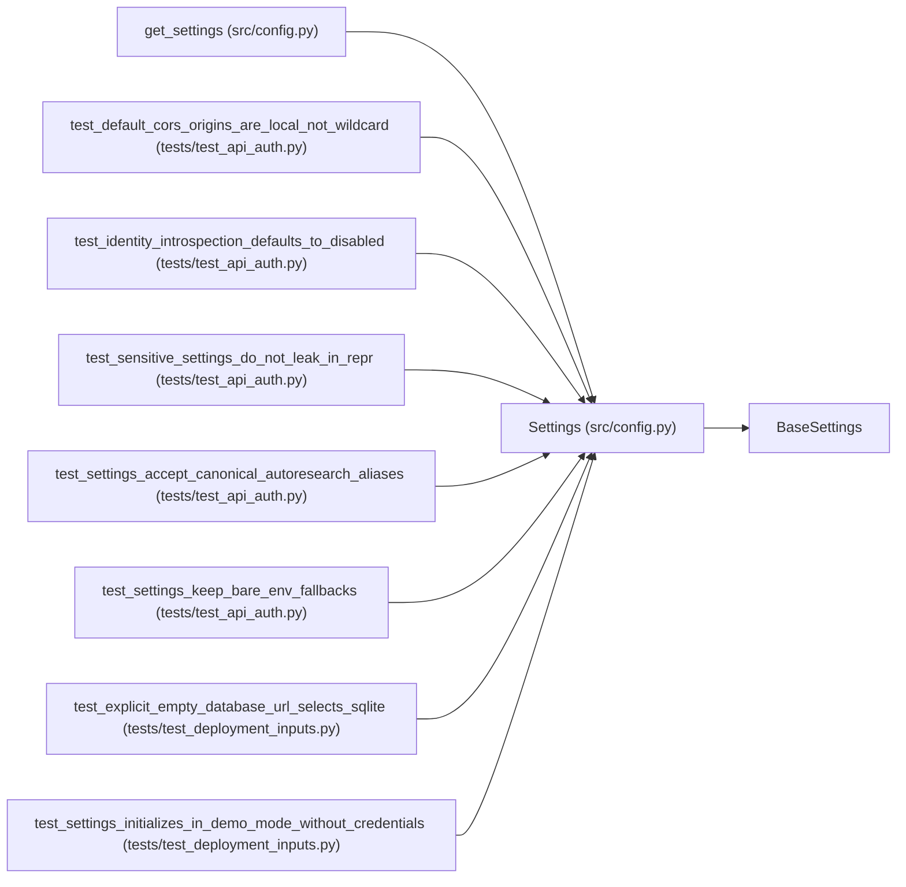

# Settings

**Location:** `src/config.py:30`
**Kind:** Pydantic model
**Bases:** `BaseSettings`
**Module:** [config](../modules/config.md)

## Description

Application settings loaded from environment variables.

## Attributes

| Name | Type | Wire name | Required | Nullable | Default | Constraints | Examples | Description |
|------|------|-----------|----------|----------|---------|-------------|-------------|----------|
| `service_name` | `str` | `unknown (AliasChoices('AUTORESEARCH_SERVICE_NAME', 'SERVICE_NAME'))` | No | No | `'autoresearch-agent'` | — | — | — |
| `host` | `str` | `unknown (AliasChoices('AUTORESEARCH_HOST', 'HOST'))` | No | No | `'0.0.0.0'` | — | — | — |
| `port` | `int` | `unknown (AliasChoices('AUTORESEARCH_PORT', 'PORT'))` | No | No | `8000` | — | — | — |
| `environment` | `str` | `unknown (AliasChoices('AUTORESEARCH_ENVIRONMENT', 'ENVIRONMENT'))` | No | No | `'development'` | — | — | — |
| `log_level` | `str` | `unknown (AliasChoices('AUTORESEARCH_LOG_LEVEL', 'LOG_LEVEL'))` | No | No | `'INFO'` | — | — | — |
| `agent_output_digest_max_chars` | `int` | `unknown (AliasChoices('AUTORESEARCH_AGENT_OUTPUT_DIGEST_MAX_CHARS', 'AGENT_OUTPUT_DIGEST_MAX_CHARS'))` | No | No | `12000` | — | — | Track D2: bash tool outputs longer than this are digested before entering the agent's context (metrics block / markers / errors kept, noise collapsed, full log persisted to the workspace). 0 disables digesting (legacy: full raw output every turn). |
| `api_v1_prefix` | `str` | `unknown (AliasChoices('AUTORESEARCH_API_V1_PREFIX', 'API_V1_PREFIX'))` | No | No | `'/api/v1'` | — | — | Preferred versioned API prefix for autoresearch routes. |
| `autoresearch_api_token` | `SecretStr \| None` | `autoresearch_api_token` | No | Yes | `None` | — | — | Bearer token required for autoresearch API and WebSocket access. |
| `autoresearch_prometheus_token` | `SecretStr \| None` | `unknown (AliasChoices('AUTORESEARCH_PROMETHEUS_TOKEN', 'PROMETHEUS_TOKEN'))` | No | Yes | `None` | — | — | Optional bearer token required to scrape /metrics. When set, callers must present 'Authorization: Bearer <token>' or the scrape is rejected with HTTP 401. Phase 5.2 hardening. |
| `identity_introspection_url` | `str` | `unknown (AliasChoices('AUTORESEARCH_IDENTITY_INTROSPECTION_URL', 'AUTORESEARCH_IDENTITY_SERVICE_URL', 'IDENTITY_SERVICE_URL'))` | No | No | `''` | — | — | Optional OAuth2 token-introspection endpoint URL (RFC 7666) used to authenticate admin JWT bearer tokens. Empty (default) disables JWT introspection; only the static API token is accepted then. |
| `identity_introspection_timeout_s` | `float` | `unknown (AliasChoices('AUTORESEARCH_IDENTITY_INTROSPECTION_TIMEOUT_S', 'IDENTITY_INTROSPECTION_TIMEOUT_S'))` | No | No | `5.0` | gt=0 | — | Timeout in seconds for token introspection. |
| `anthropic_base_url` | `str` | `anthropic_base_url` | No | No | `''` | — | — | Anthropic API base URL (e.g. https://api.anthropic.com) |
| `anthropic_auth_token` | `SecretStr \| None` | `anthropic_auth_token` | No | Yes | `None` | — | — | Anthropic API authentication token |
| `anthropic_model` | `str` | `anthropic_model` | No | No | `'claude-sonnet-4-20250514'` | — | — | Model to use for agent sessions |
| `anthropic_default_haiku_model` | `str` | `anthropic_default_haiku_model` | No | No | `'claude-haiku-4-20250514'` | — | — | Haiku-tier model alias (cheap/fast tasks like insight extraction) |
| `anthropic_default_sonnet_model` | `str` | `anthropic_default_sonnet_model` | No | No | `'claude-sonnet-4-20250514'` | — | — | Sonnet-tier model alias |
| `anthropic_default_opus_model` | `str` | `anthropic_default_opus_model` | No | No | `'claude-opus-4-20250514'` | — | — | Opus-tier model alias |
| `openai_base_url` | `str` | `openai_base_url` | No | No | `'https://api.openai.com/v1'` | — | — | OpenAI API base URL |
| `openai_api_key` | `SecretStr \| None` | `openai_api_key` | No | Yes | `None` | — | — | OpenAI API key (required when a skill selects provider: openai) |
| `openai_api_timeout_s` | `int` | `openai_api_timeout_s` | No | No | `600` | — | — | OpenAI API timeout in seconds |
| `demo_mode` | `bool` | `unknown (AliasChoices('AUTORESEARCH_DEMO', 'DEMO_MODE'))` | No | No | `False` | — | — | P0-3 demo mode: route all LLM calls to the zero-credential MockProvider. Never enable in production (refused by router). |
| `skill_generator_enabled` | `bool` | `unknown (AliasChoices('AUTORESEARCH_SKILL_GENERATOR_ENABLED', 'SKILL_GENERATOR_ENABLED'))` | No | No | `False` | — | — | P2 Skill SDK: expose POST /skills/generate (LLM-drafted skill packages). Operator opt-in — generation spends real tokens and writes validated-but-untrusted drafts into skills/_drafts/. |
| `workspace_root` | `str` | `unknown (AliasChoices('AUTORESEARCH_WORKSPACE_ROOT', 'WORKSPACE_ROOT'))` | No | No | `'/app/workspace'` | — | — | — |
| `host_configs_path` | `str` | `unknown (AliasChoices('AUTORESEARCH_HOST_CONFIGS_PATH', 'HOST_CONFIGS_PATH'))` | No | No | `'/host/configs'` | — | — | — |
| `max_iterations` | `int` | `unknown (AliasChoices('AUTORESEARCH_MAX_ITERATIONS', 'MAX_ITERATIONS'))` | No | No | `30` | — | — | — |
| `max_budget_usd` | `float` | `unknown (AliasChoices('AUTORESEARCH_MAX_BUDGET_USD', 'MAX_BUDGET_USD'))` | No | No | `10.0` | — | — | — |
| `max_output_tokens_per_call` | `int` | `unknown (AliasChoices('AUTORESEARCH_MAX_OUTPUT_TOKENS_PER_CALL', 'MAX_OUTPUT_TOKENS_PER_CALL'))` | No | No | `8192` | ge=128 | — | Hard cap on max_tokens per LLM call (clamped at the historical 8192 ceiling regardless of how high this is set). |
| `max_input_tokens_per_call` | `int` | `unknown (AliasChoices('AUTORESEARCH_MAX_INPUT_TOKENS_PER_CALL', 'MAX_INPUT_TOKENS_PER_CALL'))` | No | No | `0` | ge=0 | — | 0 = uncapped. When >0, a turn whose previous call consumed more input tokens than this forces hardest context compaction before the next call (keeps per-call spend bounded on long sessions). |
| `experiment_timeout_s` | `int` | `unknown (AliasChoices('AUTORESEARCH_TIMEOUT_S', 'AUTORESEARCH_EXPERIMENT_TIMEOUT_S', 'EXPERIMENT_TIMEOUT_S'))` | No | No | `14400` | — | — | — |
| `default_quick_mode` | `bool` | `unknown (AliasChoices('AUTORESEARCH_DEFAULT_QUICK_MODE', 'DEFAULT_QUICK_MODE'))` | No | No | `True` | — | — | Quick mode by default (2 folds, 50k steps). Override per-session with quick_mode=false. |
| `max_concurrent_sessions` | `int` | `unknown (AliasChoices('AUTORESEARCH_MAX_CONCURRENT', 'AUTORESEARCH_MAX_CONCURRENT_SESSIONS', 'MAX_CONCURRENT_SESSIONS'))` | No | No | `2` | — | — | — |
| `anthropic_api_timeout_s` | `int` | `unknown (AliasChoices('AUTORESEARCH_ANTHROPIC_API_TIMEOUT_S', 'ANTHROPIC_API_TIMEOUT_S'))` | No | No | `600` | — | — | Per-request timeout for Anthropic API calls (seconds). |
| `max_api_retries` | `int` | `unknown (AliasChoices('AUTORESEARCH_MAX_API_RETRIES', 'MAX_API_RETRIES'))` | No | No | `3` | — | — | Max retries on transient API errors (timeout, 500, 429). |
| `context_compaction_threshold` | `int` | `unknown (AliasChoices('AUTORESEARCH_CONTEXT_COMPACTION_THRESHOLD', 'CONTEXT_COMPACTION_THRESHOLD'))` | No | No | `80` | — | — | Number of messages before old tool results are compacted. |
| `global_stagnation_window` | `int` | `unknown (AliasChoices('AUTORESEARCH_GLOBAL_STAGNATION_WINDOW', 'GLOBAL_STAGNATION_WINDOW'))` | No | No | `12` | ge=1 | — | AR-7: Number of consecutive iterations with no metric improvement that triggers a GLOBAL_STAGNATION nudge demanding TERMINATE_REQUEST. |
| `global_stagnation_epsilon` | `float` | `unknown (AliasChoices('AUTORESEARCH_GLOBAL_STAGNATION_EPSILON', 'GLOBAL_STAGNATION_EPSILON'))` | No | No | `0.0001` | ge=0.0 | — | AR-7: Minimum metric improvement above the session best required to reset the stagnation window. Improvements <= epsilon are treated as stagnant. |
| `stagnation_exempt_phases` | `List[str]` | `unknown (AliasChoices('AUTORESEARCH_STAGNATION_EXEMPT_PHASES', 'STAGNATION_EXEMPT_PHASES'))` | No | No | `['baseline_capture', 'robustness', 'promotion_proposal']` | — | — | Phases where metric stagnation is expected (validation/evidence work, not hyperparameter tuning). The global stagnation guard is suppressed when the session is in one of these phases. |
| `iteration_context_enabled` | `bool` | `unknown (AliasChoices('AUTORESEARCH_ITERATION_CONTEXT_ENABLED', 'ITERATION_CONTEXT_ENABLED'))` | No | No | `True` | — | — | Inject a compact persisted-iteration digest after recorded attempts. |
| `iteration_context_max_chars` | `int` | `unknown (AliasChoices('AUTORESEARCH_ITERATION_CONTEXT_MAX_CHARS', 'ITERATION_CONTEXT_MAX_CHARS'))` | No | No | `6000` | ge=500 | — | Maximum characters in the injected iteration context digest. |
| `iteration_context_recent_attempts` | `int` | `unknown (AliasChoices('AUTORESEARCH_ITERATION_CONTEXT_RECENT_ATTEMPTS', 'ITERATION_CONTEXT_RECENT_ATTEMPTS'))` | No | No | `5` | ge=1 | — | Number of recent attempts summarized in iteration context. |
| `autoresearch_cross_session_duplicate_check` | `bool` | `unknown (AliasChoices('AUTORESEARCH_CROSS_SESSION_DUPLICATE_CHECK', 'AUTORESEARCH_ENABLE_CROSS_SESSION_DUPLICATE_CHECK'))` | No | No | `True` | — | — | Reject duplicate config/seed/mode/split attempts across prior sessions for the same instrument, timeframe, and model type. Phase 3.4: default flipped to True so wasted compute on already-explored points is the opt-out, not the opt-in. |
| `ws_max_clients` | `int` | `unknown (AliasChoices('AUTORESEARCH_WS_MAX_CLIENTS', 'WS_MAX_CLIENTS'))` | No | No | `100` | ge=1 | — | Maximum concurrently connected WebSocket event clients. |
| `mlflow_tracking_uri` | `str` | `mlflow_tracking_uri` | No | No | `''` | — | — | MLflow tracking server URI (e.g. http://mlflow:5000). Empty disables MLflow integration. |
| `mlflow_external_url` | `str` | `mlflow_external_url` | No | No | `''` | — | — | Browser-accessible MLflow URL for deep-linking from UI |
| `production_approval_verifier` | `SecretStr \| None` | `unknown (AliasChoices('AUTORESEARCH_PRODUCTION_APPROVAL_VERIFIER', 'PRODUCTION_APPROVAL_VERIFIER'))` | No | Yes | `None` | — | — | HMAC-SHA256 secret used to verify the signature on production-scope promotion approvals (W18 / P0-020). When unset, all production promotions are rejected (fail-closed). The approval.signature must be the hex HMAC-SHA256 of '{research_id}:{scope}:{approver}' keyed by this secret. |
| `result_receipt_key` | `SecretStr \| None` | `unknown (AliasChoices('AUTORESEARCH_RESULT_RECEIPT_KEY', 'RESULT_RECEIPT_KEY'))` | No | Yes | `None` | — | — | Server-only HMAC-SHA256 key for authenticated result receipts when evaluator results cross a trust boundary. Never delivered to candidates or evaluators. When unset, receipts use deterministic digest ids (tamper-evident and idempotent within the server's own records). |
| `preflight_enabled` | `bool` | `unknown (AliasChoices('AUTORESEARCH_PREFLIGHT_ENABLED', 'PREFLIGHT_ENABLED'))` | No | No | `True` | — | — | Run service dependency checks before starting research sessions. |
| `allow_unready_services` | `bool` | `unknown (AliasChoices('AUTORESEARCH_ALLOW_UNREADY_SERVICES', 'ALLOW_UNREADY_SERVICES'))` | No | No | `False` | — | — | Dedicated override allowing sessions to start when preflight fails. |
| `preflight_timeout_s` | `float` | `unknown (AliasChoices('AUTORESEARCH_PREFLIGHT_TIMEOUT_S', 'PREFLIGHT_TIMEOUT_S'))` | No | No | `3.0` | gt=0 | — | Per-service preflight timeout in seconds. |
| `cors_origins_raw` | `str` | `unknown (AliasChoices('AUTORESEARCH_CORS_ORIGINS', 'CORS_ORIGINS_RAW', 'CORS_ORIGINS'))` | No | No | `DEFAULT_CORS_ORIGINS` | — | — | — |
| `database_url` | `str \| None` | `unknown (AliasChoices('AUTORESEARCH_DATABASE_URL', 'DATABASE_URL'))` | No | Yes | `None` | — | — | Optional Postgres DSN enabling the PostgresStateStore backend (ARC-011 Phase 6 / R6). When unset (or when the DSN is a sqlite URL), the service uses SQLiteStateStore and the WEB_CONCURRENCY>1 guard stays active (W14). Set to a postgresql:// (or postgresql+asyncpg://) DSN to enable horizontal scaling. |

## Methods

| Method | Signature | Decorators | Description |
|--------|-----------|------------|-------------|
| `cors_origins` | `() -> List[str]` | `@property` | — |
| `db_path` | `() -> str` | `@property` | — |
| `skills_dir` | `() -> str` | `@property` | — |
| `configs_dir` | `() -> str` | `@property` | — |
| `runs_dir` | `() -> str` | `@property` | — |
| `venv_python` | `() -> str` | `@property` | — |

## Relationships

<!-- Auto-generated relationship summary. Do not edit by hand. -->

### Summary

| Module | Methods | Attributes |
|---|---:|---|
| [config](../modules/config.md) | 6 | `agent_output_digest_max_chars`, `allow_unready_services`, `anthropic_api_timeout_s`, `anthropic_auth_token`, `anthropic_base_url`, `anthropic_default_haiku_model`, `anthropic_default_opus_model`, `anthropic_default_sonnet_model`, `anthropic_model`, `api_v1_prefix`, `autoresearch_api_token`, `autoresearch_cross_session_duplicate_check` |

### Structure

| Kind | Entity | Module |
|---|---|---|
| Base | `BaseSettings` | — |

### References

| Reference | Kind | Source | Call sites |
|---|---|---|---:|
| `get_settings` | call | [config](../modules/config.md) | 1 |
| `get_settings` | type_reference | [config](../modules/config.md) | — |
| `test_default_cors_origins_are_local_not_wildcard` | call | [test_api_auth](../modules/test_api_auth.md) | 1 |
| `test_identity_introspection_defaults_to_disabled` | call | [test_api_auth](../modules/test_api_auth.md) | 1 |
| `test_sensitive_settings_do_not_leak_in_repr` | call | [test_api_auth](../modules/test_api_auth.md) | 1 |
| `test_settings_accept_canonical_autoresearch_aliases` | call | [test_api_auth](../modules/test_api_auth.md) | 1 |
| `test_settings_keep_bare_env_fallbacks` | call | [test_api_auth](../modules/test_api_auth.md) | 1 |
| `test_explicit_empty_database_url_selects_sqlite` | call | [test_deployment_inputs](../modules/test_deployment_inputs.md) | 1 |
| `test_settings_initializes_in_demo_mode_without_credentials` | call | [test_deployment_inputs](../modules/test_deployment_inputs.md) | 1 |
