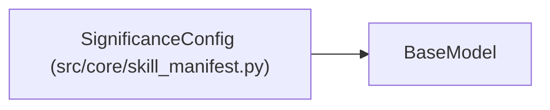

# SignificanceConfig

**Location:** `src/core/skill_manifest.py:272`
**Kind:** Pydantic model
**Bases:** `BaseModel`
**Module:** [skill_manifest](../modules/skill_manifest.md)

## Description

Multi-seed significance gate (P2 ops — ``metric_schema.significance``).

When declared, keep/discard decisions compare mean±standard-error across
repeated observations of the same config (each seed rerun is a new
sample; the trial-identity hash keeps them distinct) instead of the
fixed-epsilon point test. Absent ⇒ legacy behavior, byte-identical.

## Model Configuration

| Setting | Value | Source |
|---------|-------|--------|
| `extra` | `'forbid'` | model_config |

## Attributes

| Name | Type | Wire name | Required | Nullable | Default | Constraints | Examples | Description |
|------|------|-----------|----------|----------|---------|-------------|-------------|----------|
| `min_samples` | `int` | `min_samples` | No | No | `2` | ge=1; le=10 | — | — |
| `min_sigma` | `float` | `min_sigma` | No | No | `1.0` | ge=0.0 | — | — |

## Methods

*No public methods. Inherits from base classes.*

## Relationships

<!-- Auto-generated relationship summary. Do not edit by hand. -->

### Summary

| Module | Methods | Attributes |
|---|---:|---|
| [skill_manifest](../modules/skill_manifest.md) | 0 | `min_samples`, `min_sigma` |

### Structure

| Kind | Entity | Module |
|---|---|---|
| Base | `BaseModel` | — |
