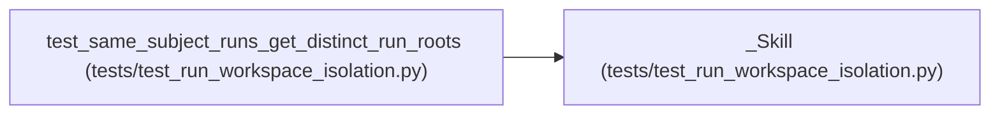

# _Skill

**Location:** `tests/test_run_workspace_isolation.py:24`
**Kind:** Class
**Bases:** —
**Module:** [test_run_workspace_isolation](../modules/test_run_workspace_isolation.md)

## Description

_Auto-generated from `_Skill` in `tests/test_run_workspace_isolation.py`._

## Attributes

*No annotated attributes found.*

## Methods

*No public methods. Inherits from base classes.*

## Relationships

<!-- Auto-generated relationship summary. Do not edit by hand. -->

### Summary

| Module | Methods | Attributes |
|---|---:|---|
| [test_run_workspace_isolation](../modules/test_run_workspace_isolation.md) | 0 | — |

### References

| Reference | Kind | Source | Call sites |
|---|---|---|---:|
| `test_same_subject_runs_get_distinct_run_roots` | call | [test_run_workspace_isolation](../modules/test_run_workspace_isolation.md) | 1 |
