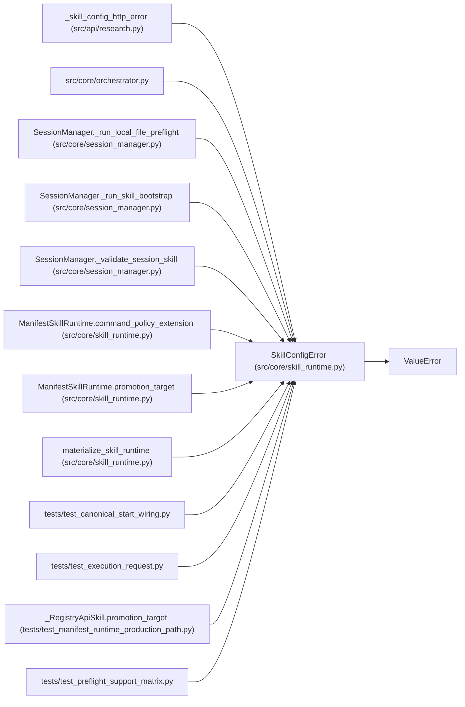

# SkillConfigError

**Location:** `src/core/skill_runtime.py:66`
**Kind:** Class
**Bases:** `ValueError`
**Module:** [skill_runtime](../modules/skill_runtime.md)

## Description

A skill manifest declares something the runtime cannot honor.

ARC-011 review C2 (2026-08-15): raised when the manifest-driven runtime
hits a declaration with no wired implementation (e.g.
``promotion_target.kind=registry_api`` on the config-promotion path) —
surfacing the deployment error loudly instead of silently downgrading
to a default behavior. ``ValueError`` base matches the
``ManifestValidationError`` convention in ``skill_manifest.py``.

## Attributes

*No annotated attributes found.*

## Methods

*No public methods. Inherits from base classes.*

## Relationships

<!-- Auto-generated relationship summary. Do not edit by hand. -->

### Summary

| Module | Methods | Attributes |
|---|---:|---|
| [skill_runtime](../modules/skill_runtime.md) | 0 | — |

### Structure

| Kind | Entity | Module |
|---|---|---|
| Base | `ValueError` | — |

### References

| Reference | Kind | Source | Call sites |
|---|---|---|---:|
| `_skill_config_http_error` | type_reference | [research](../modules/research.md) | — |
| `orchestrator` | import | [orchestrator](../modules/orchestrator.md) | — |
| `SessionManager._run_local_file_preflight` | call | [session_manager](../modules/session_manager.md) | 1 |
| `SessionManager._run_skill_bootstrap` | call | [session_manager](../modules/session_manager.md) | 2 |
| `SessionManager._validate_session_skill` | call | [session_manager](../modules/session_manager.md) | 1 |
| `ManifestSkillRuntime.command_policy_extension` | call | [skill_runtime](../modules/skill_runtime.md) | 3 |
| `ManifestSkillRuntime.promotion_target` | call | [skill_runtime](../modules/skill_runtime.md) | 1 |
| `materialize_skill_runtime` | call | [skill_runtime](../modules/skill_runtime.md) | 3 |
| `test_canonical_start_wiring` | import | [test_canonical_start_wiring](../modules/test_canonical_start_wiring.md) | — |
| `test_execution_request` | import | [test_execution_request](../modules/test_execution_request.md) | — |
| `_RegistryApiSkill.promotion_target` | call | [test_manifest_runtime_production_path](../modules/test_manifest_runtime_production_path.md) | 1 |
| `test_preflight_support_matrix` | import | [test_preflight_support_matrix](../modules/test_preflight_support_matrix.md) | — |

> References: showing 12 of 14 logical references; 2 omitted by the 12-row generated summary limit.
