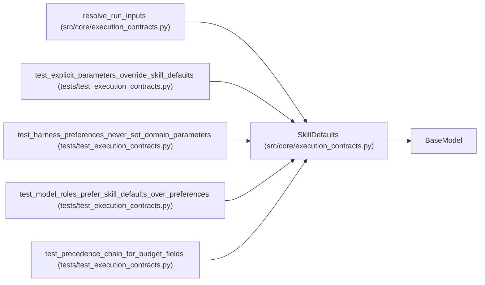

# SkillDefaults

**Location:** `src/core/execution_contracts.py:983`
**Kind:** Pydantic model
**Bases:** `BaseModel`
**Module:** [execution_contracts](../modules/execution_contracts.md)

## Description

Defaults declared by the skill package (domain behavior).

## Model Configuration

| Setting | Value | Source |
|---------|-------|--------|
| `extra` | `'forbid'` | model_config |

## Attributes

| Name | Type | Wire name | Required | Nullable | Default | Constraints | Examples | Description |
|------|------|-----------|----------|----------|---------|-------------|-------------|----------|
| `parameters` | `dict[str, Any]` | `parameters` | No | No | factory: `dict` | — | — | — |
| `budget` | `dict[str, Any]` | `budget` | No | No | factory: `dict` | — | — | — |
| `model_roles` | `dict[str, str]` | `model_roles` | No | No | factory: `dict` | — | — | — |

## Methods

*No public methods. Inherits from base classes.*

## Relationships

<!-- Auto-generated relationship summary. Do not edit by hand. -->

### Summary

| Module | Methods | Attributes |
|---|---:|---|
| [execution_contracts](../modules/execution_contracts.md) | 0 | `budget`, `model_roles`, `parameters` |

### Structure

| Kind | Entity | Module |
|---|---|---|
| Base | `BaseModel` | — |

### References

| Reference | Kind | Source | Call sites |
|---|---|---|---:|
| `resolve_run_inputs` | call | [execution_contracts](../modules/execution_contracts.md) | 1 |
| `resolve_run_inputs` | type_reference | [execution_contracts](../modules/execution_contracts.md) | — |
| `test_explicit_parameters_override_skill_defaults` | call | [test_execution_contracts](../modules/test_execution_contracts.md) | 1 |
| `test_harness_preferences_never_set_domain_parameters` | call | [test_execution_contracts](../modules/test_execution_contracts.md) | 1 |
| `test_model_roles_prefer_skill_defaults_over_preferences` | call | [test_execution_contracts](../modules/test_execution_contracts.md) | 1 |
| `test_precedence_chain_for_budget_fields` | call | [test_execution_contracts](../modules/test_execution_contracts.md) | 1 |
