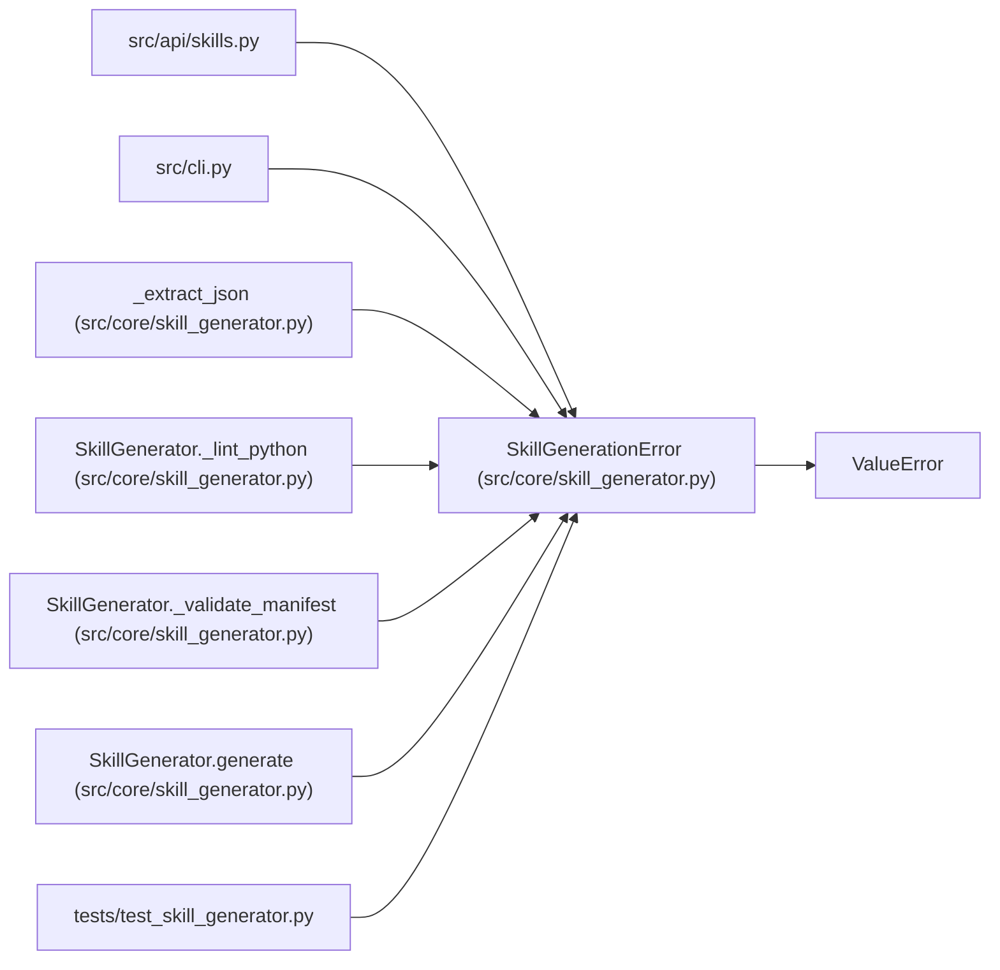

# SkillGenerationError

**Location:** `src/core/skill_generator.py:97`
**Kind:** Class
**Bases:** `ValueError`
**Module:** [skill_generator](../modules/skill_generator.md)

## Description

Raised when a draft cannot be generated (LLM failure, schema invalid, …).

## Attributes

*No annotated attributes found.*

## Methods

*No public methods. Inherits from base classes.*

## Relationships

<!-- Auto-generated relationship summary. Do not edit by hand. -->

### Summary

| Module | Methods | Attributes |
|---|---:|---|
| [skill_generator](../modules/skill_generator.md) | 0 | — |

### Structure

| Kind | Entity | Module |
|---|---|---|
| Base | `ValueError` | — |

### References

| Reference | Kind | Source | Call sites |
|---|---|---|---:|
| `skills` | import | [src_api_skills](../modules/src_api_skills.md) | — |
| `cli` | import | [cli](../modules/cli.md) | — |
| `_extract_json` | call | [skill_generator](../modules/skill_generator.md) | 3 |
| `SkillGenerator._lint_python` | call | [skill_generator](../modules/skill_generator.md) | 1 |
| `SkillGenerator._validate_manifest` | call | [skill_generator](../modules/skill_generator.md) | 1 |
| `SkillGenerator.generate` | call | [skill_generator](../modules/skill_generator.md) | 4 |
| `test_skill_generator` | import | [test_skill_generator](../modules/test_skill_generator.md) | — |
