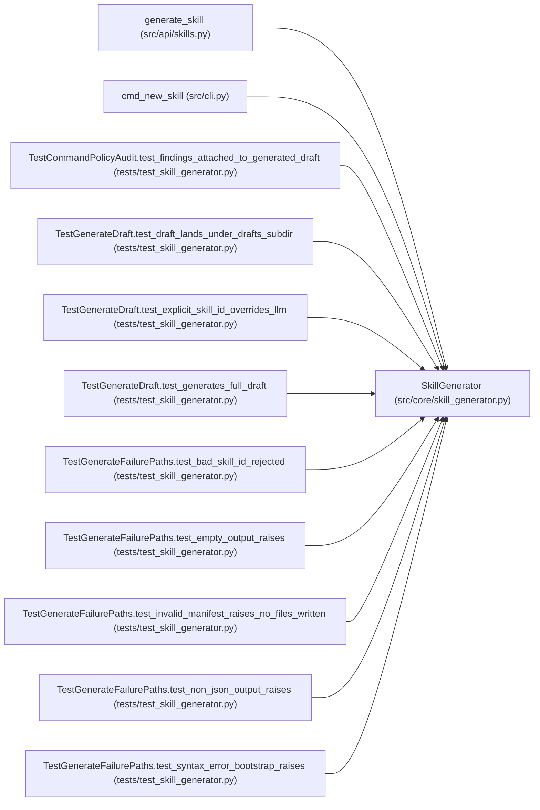

# SkillGenerator

**Location:** `src/core/skill_generator.py:208`
**Kind:** Class
**Bases:** —
**Module:** [skill_generator](../modules/skill_generator.md)

## Description

Draft a new skill package from a natural-language description (P5-023).

Parameters
----------
registry:
    The ``SkillRegistry`` (used to resolve the drafts root).
drafts_root_override:
    Optional override for the ``skills/_drafts/`` dir (tests).

## Attributes

*No annotated attributes found.*

## Methods

| Method | Signature | Decorators | Description |
|--------|-----------|------------|-------------|
| `__init__` | `(*, registry: Optional[SkillRegistry] = None, drafts_root_override: Optional[Path] = None) -> None` | — | — |
| `drafts_root` | `() -> Path` | `@property` | — |
| `generate` | *(async)* `(*, description: str, provider: Any, model: str, skill_id: Optional[str] = None) -> GeneratedDraft` | — | Generate a draft skill package (P5-023). |
| `_validate_manifest` | `(manifest_yaml: str) -> None` | — | — |
| `_lint_python` | `(source: str, label: str) -> None` | — | — |
| `_write_draft` | `(*, skill_id: str, manifest_yaml: str, bootstrap_py: str, eval_run_py: Optional[str], skill_md: str) -> Path` | — | — |

## Relationships

<!-- Auto-generated relationship summary. Do not edit by hand. -->

### Summary

| Module | Methods | Attributes |
|---|---:|---|
| [skill_generator](../modules/skill_generator.md) | 6 | — |

### References

| Reference | Kind | Source | Call sites |
|---|---|---|---:|
| `generate_skill` | call | [src_api_skills](../modules/src_api_skills.md) | 1 |
| `cmd_new_skill` | call | [cli](../modules/cli.md) | 1 |
| `TestCommandPolicyAudit.test_findings_attached_to_generated_draft` | call | [test_skill_generator](../modules/test_skill_generator.md) | 1 |
| `TestGenerateDraft.test_draft_lands_under_drafts_subdir` | call | [test_skill_generator](../modules/test_skill_generator.md) | 1 |
| `TestGenerateDraft.test_explicit_skill_id_overrides_llm` | call | [test_skill_generator](../modules/test_skill_generator.md) | 1 |
| `TestGenerateDraft.test_generates_full_draft` | call | [test_skill_generator](../modules/test_skill_generator.md) | 1 |
| `TestGenerateFailurePaths.test_bad_skill_id_rejected` | call | [test_skill_generator](../modules/test_skill_generator.md) | 1 |
| `TestGenerateFailurePaths.test_empty_output_raises` | call | [test_skill_generator](../modules/test_skill_generator.md) | 1 |
| `TestGenerateFailurePaths.test_invalid_manifest_raises_no_files_written` | call | [test_skill_generator](../modules/test_skill_generator.md) | 1 |
| `TestGenerateFailurePaths.test_non_json_output_raises` | call | [test_skill_generator](../modules/test_skill_generator.md) | 1 |
| `TestGenerateFailurePaths.test_syntax_error_bootstrap_raises` | call | [test_skill_generator](../modules/test_skill_generator.md) | 1 |
