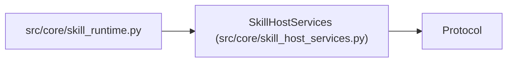

# SkillHostServices

**Location:** `src/core/skill_host_services.py:15`
**Kind:** Class
**Bases:** `Protocol`
**Module:** [skill_host_services](../modules/skill_host_services.md)

## Description

The host's explicit, stable surface for skill runtimes.

## Attributes

*No annotated attributes found.*

## Methods

| Method | Signature | Decorators | Description |
|--------|-----------|------------|-------------|
| `load_claude_md` | `() -> str` | — | The workspace's agent instructions (empty when absent). |
| `load_research_resume` | `(config: Any) -> str` | — | The cross-session resume material for this run (may be empty). |
| `build_phase_contract_block` | `(config: Any) -> str` | — | The rendered phase contract for this run (may be empty). |
| `research_resume_path` | `(config: Any) -> str` | — | Where this run's cross-session resume file lives. |

## Relationships

<!-- Auto-generated relationship summary. Do not edit by hand. -->

### Summary

| Module | Methods | Attributes |
|---|---:|---|
| [skill_host_services](../modules/skill_host_services.md) | 4 | — |

### Structure

| Kind | Entity | Module |
|---|---|---|
| Base | `Protocol` | — |

### References

| Reference | Kind | Source | Call sites |
|---|---|---|---:|
| `skill_runtime` | import | [skill_runtime](../modules/skill_runtime.md) | — |
