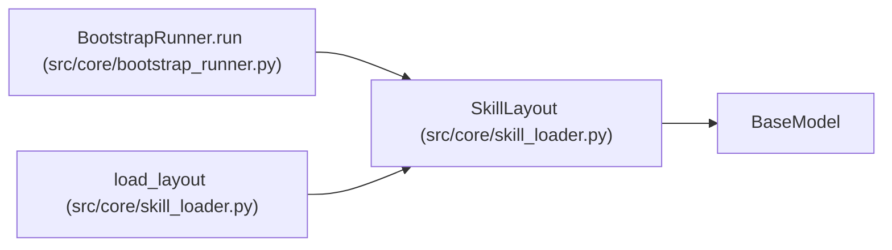

# SkillLayout

**Location:** `src/core/skill_loader.py:99`
**Kind:** Pydantic model
**Bases:** `BaseModel`
**Module:** [skill_loader](../modules/skill_loader.md)

## Description

Resolved on-disk layout of a skill package (ARC-011 §5.3, P5-001).

Pure metadata: which optional files/dirs exist, which plugins are declared,
and the resolved capability grant per plugin. Produces *no* side effects —
nothing is executed here. The ``BootstrapRunner`` (P5-005) and the
``PluginRunner`` consume the resolved layout + caps at session start.

Design decisions (P1-007 house style):
* **Path-existence checks only.** Resolution reads the filesystem; it never
  imports or runs the discovered modules. Trust boundary enforced at the
  ``PluginRunner`` subprocess (X-004 D2/D4).
* **Back-compat.** Every optional field defaults to absent; existing skills
  with only ``SKILL.yaml``/``SKILL.md`` produce a valid (minimal) layout.
* **Caps are resolved, not authored.** The manifest's ``plugins.entries``
  may omit ``caps``; resolution back-fills the X-004 per-kind default. A
  manifest that *narrows* a default keeps its narrower grant; one that
  *widens* beyond the kind default is rejected (R10 defense in depth).

## Model Configuration

| Setting | Value | Source |
|---------|-------|--------|
| `extra` | `'forbid'` | model_config |

## Attributes

| Name | Type | Wire name | Required | Nullable | Default | Constraints | Examples | Description |
|------|------|-----------|----------|----------|---------|-------------|-------------|----------|
| `skill_dir` | `Path` | `skill_dir` | Yes | No | — | — | — | — |
| `has_bootstrap` | `bool` | `has_bootstrap` | No | No | `False` | — | — | — |
| `has_scaffold` | `bool` | `has_scaffold` | No | No | `False` | — | — | — |
| `has_knowledge` | `bool` | `has_knowledge` | No | No | `False` | — | — | — |
| `has_eval` | `bool` | `has_eval` | No | No | `False` | — | — | — |
| `has_tools` | `bool` | `has_tools` | No | No | `False` | — | — | — |
| `plugins` | `dict[PluginKind, PluginEntry]` | `plugins` | No | No | factory: `dict` | — | — | — |
| `missing_plugin_paths` | `list[str]` | `missing_plugin_paths` | No | No | factory: `list` | — | — | — |

## Methods

*No public methods. Inherits from base classes.*

## Relationships

<!-- Auto-generated relationship summary. Do not edit by hand. -->

### Summary

| Module | Methods | Attributes |
|---|---:|---|
| [skill_loader](../modules/skill_loader.md) | 0 | `has_bootstrap`, `has_eval`, `has_knowledge`, `has_scaffold`, `has_tools`, `missing_plugin_paths`, `plugins`, `skill_dir` |

### Structure

| Kind | Entity | Module |
|---|---|---|
| Base | `BaseModel` | — |

### References

| Reference | Kind | Source | Call sites |
|---|---|---|---:|
| `BootstrapRunner.run` | type_reference | [bootstrap_runner](../modules/bootstrap_runner.md) | — |
| `load_layout` | call | [skill_loader](../modules/skill_loader.md) | 1 |
| `load_layout` | type_reference | [skill_loader](../modules/skill_loader.md) | — |
