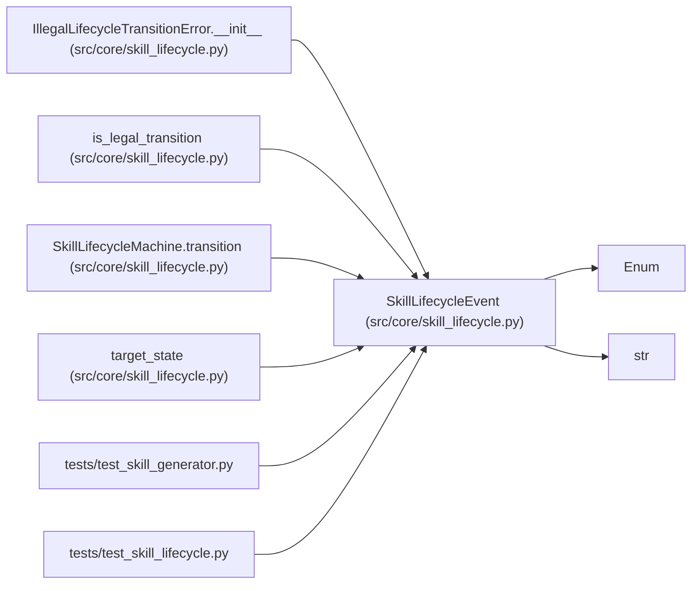

# SkillLifecycleEvent

**Location:** `src/core/skill_lifecycle.py:61`
**Kind:** Enum
**Bases:** `str`, `Enum`
**Module:** [skill_lifecycle](../modules/skill_lifecycle.md)

## Description

Operator-initiated lifecycle events.

## Attributes

| Name | Declared value | Description |
|------|-------|-------------|
| `SUBMIT_FOR_REVIEW` | `'submit_for_review'` | — |
| `APPROVE` | `'approve'` | — |
| `DEPRECATE` | `'deprecate'` | — |
| `UN_RETIRE` | `'un_retire'` | — |

## Methods

*No public methods. Inherits from base classes.*

## Relationships

<!-- Auto-generated relationship summary. Do not edit by hand. -->

### Summary

| Module | Methods | Attributes |
|---|---:|---|
| [skill_lifecycle](../modules/skill_lifecycle.md) | 0 | `APPROVE`, `DEPRECATE`, `SUBMIT_FOR_REVIEW`, `UN_RETIRE` |

### Structure

| Kind | Entity | Module |
|---|---|---|
| Base | `Enum` | — |
| Base | `str` | — |

### References

| Reference | Kind | Source | Call sites |
|---|---|---|---:|
| `IllegalLifecycleTransitionError.__init__` | type_reference | [skill_lifecycle](../modules/skill_lifecycle.md) | — |
| `is_legal_transition` | type_reference | [skill_lifecycle](../modules/skill_lifecycle.md) | — |
| `SkillLifecycleMachine.transition` | type_reference | [skill_lifecycle](../modules/skill_lifecycle.md) | — |
| `target_state` | type_reference | [skill_lifecycle](../modules/skill_lifecycle.md) | — |
| `test_skill_generator` | import | [test_skill_generator](../modules/test_skill_generator.md) | — |
| `test_skill_lifecycle` | import | [test_skill_lifecycle](../modules/test_skill_lifecycle.md) | — |
