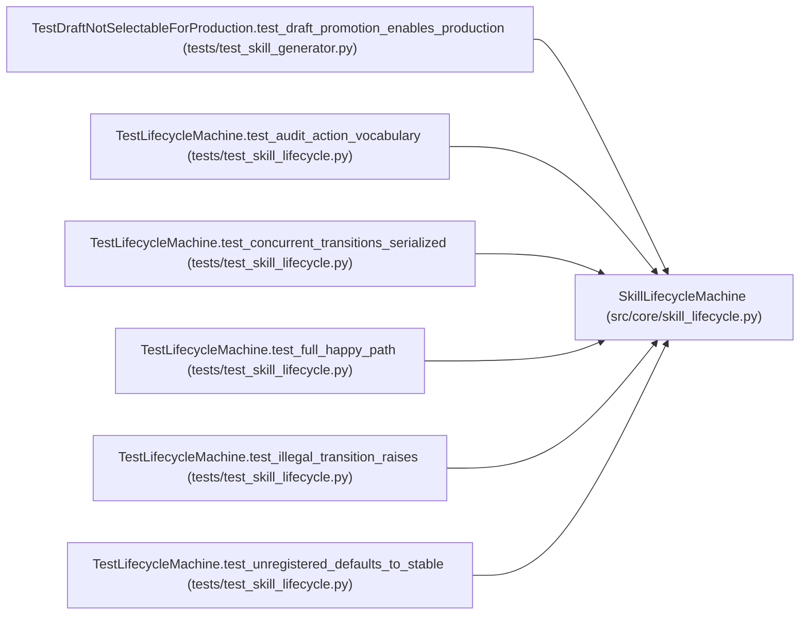

# SkillLifecycleMachine

**Location:** `src/core/skill_lifecycle.py:149`
**Kind:** Class
**Bases:** —
**Module:** [skill_lifecycle](../modules/skill_lifecycle.md)

## Description

Per-skill lifecycle state machine (P5-010).

Holds the current state for a set of skill ids and serializes transitions
under a per-skill ``asyncio.Lock``. The machine owns ONLY state + returns a
``LifecycleTransitionResult``; the caller performs the file-move / audit /
broadcast side-effects (house-style separation — see ``state_machine.py``).

## Attributes

*No annotated attributes found.*

## Methods

| Method | Signature | Decorators | Description |
|--------|-----------|------------|-------------|
| `__init__` | `() -> None` | — | — |
| `register` | `(skill_id: str, state: Optional[SkillLifecycleState] = None) -> None` | — | Record the initial state for ``skill_id`` (idempotent; first write wins |
| `get_state` | `(skill_id: str) -> SkillLifecycleState` | — | Current state; defaults to ``stable`` if never registered. |
| `_lock_for` | `(skill_id: str) -> asyncio.Lock` | — | — |
| `transition` | *(async)* `(skill_id: str, event: SkillLifecycleEvent) -> LifecycleTransitionResult` | — | Apply ``event`` to ``skill_id`` under its per-skill lock. |

## Relationships

<!-- Auto-generated relationship summary. Do not edit by hand. -->

### Summary

| Module | Methods | Attributes |
|---|---:|---|
| [skill_lifecycle](../modules/skill_lifecycle.md) | 5 | — |

### References

| Reference | Kind | Source | Call sites |
|---|---|---|---:|
| `TestDraftNotSelectableForProduction.test_draft_promotion_enables_production` | call | [test_skill_generator](../modules/test_skill_generator.md) | 1 |
| `TestLifecycleMachine.test_audit_action_vocabulary` | call | [test_skill_lifecycle](../modules/test_skill_lifecycle.md) | 1 |
| `TestLifecycleMachine.test_concurrent_transitions_serialized` | call | [test_skill_lifecycle](../modules/test_skill_lifecycle.md) | 1 |
| `TestLifecycleMachine.test_full_happy_path` | call | [test_skill_lifecycle](../modules/test_skill_lifecycle.md) | 1 |
| `TestLifecycleMachine.test_illegal_transition_raises` | call | [test_skill_lifecycle](../modules/test_skill_lifecycle.md) | 1 |
| `TestLifecycleMachine.test_unregistered_defaults_to_stable` | call | [test_skill_lifecycle](../modules/test_skill_lifecycle.md) | 1 |
