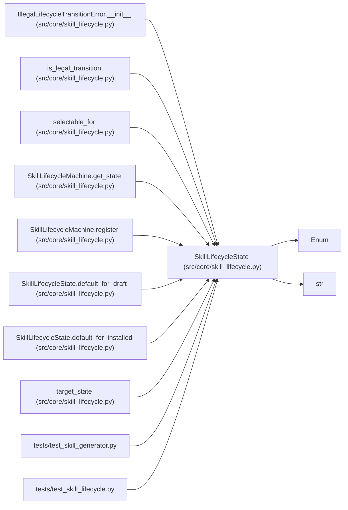

# SkillLifecycleState

**Location:** `src/core/skill_lifecycle.py:42`
**Kind:** Enum
**Bases:** `str`, `Enum`
**Module:** [skill_lifecycle](../modules/skill_lifecycle.md)

## Description

The four lifecycle states a skill package moves through (ARC-011 §8.7).

## Attributes

| Name | Declared value | Description |
|------|-------|-------------|
| `DRAFT` | `'draft'` | — |
| `REVIEWED` | `'reviewed'` | — |
| `STABLE` | `'stable'` | — |
| `DEPRECATED` | `'deprecated'` | — |

## Methods

| Method | Signature | Decorators | Description |
|--------|-----------|------------|-------------|
| `default_for_installed` | `() -> 'SkillLifecycleState'` | `@classmethod` | Operator-installed skills (dropped under ``skills/<id>/``) start here. |
| `default_for_draft` | `() -> 'SkillLifecycleState'` | `@classmethod` | Generator output (under ``skills/_drafts/<id>/``) starts here. |

## Relationships

<!-- Auto-generated relationship summary. Do not edit by hand. -->

### Summary

| Module | Methods | Attributes |
|---|---:|---|
| [skill_lifecycle](../modules/skill_lifecycle.md) | 2 | `DEPRECATED`, `DRAFT`, `REVIEWED`, `STABLE` |

### Structure

| Kind | Entity | Module |
|---|---|---|
| Base | `Enum` | — |
| Base | `str` | — |

### References

| Reference | Kind | Source | Call sites |
|---|---|---|---:|
| `IllegalLifecycleTransitionError.__init__` | type_reference | [skill_lifecycle](../modules/skill_lifecycle.md) | — |
| `is_legal_transition` | type_reference | [skill_lifecycle](../modules/skill_lifecycle.md) | — |
| `selectable_for` | type_reference | [skill_lifecycle](../modules/skill_lifecycle.md) | — |
| `SkillLifecycleMachine.get_state` | type_reference | [skill_lifecycle](../modules/skill_lifecycle.md) | — |
| `SkillLifecycleMachine.register` | type_reference | [skill_lifecycle](../modules/skill_lifecycle.md) | — |
| `SkillLifecycleState.default_for_draft` | type_reference | [skill_lifecycle](../modules/skill_lifecycle.md) | — |
| `SkillLifecycleState.default_for_installed` | type_reference | [skill_lifecycle](../modules/skill_lifecycle.md) | — |
| `target_state` | type_reference | [skill_lifecycle](../modules/skill_lifecycle.md) | — |
| `test_skill_generator` | import | [test_skill_generator](../modules/test_skill_generator.md) | — |
| `test_skill_lifecycle` | import | [test_skill_lifecycle](../modules/test_skill_lifecycle.md) | — |
