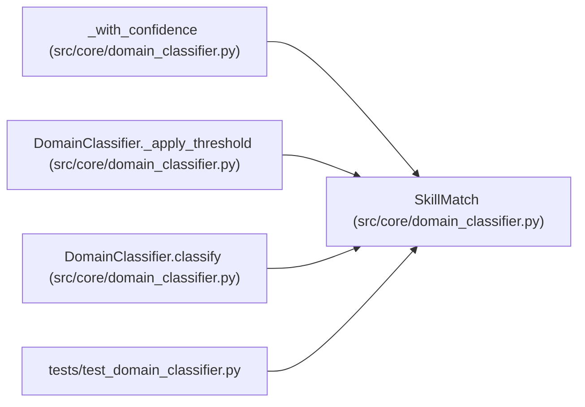

# SkillMatch

**Location:** `src/core/domain_classifier.py:184`
**Kind:** Class
**Bases:** —
**Module:** [domain_classifier](../modules/domain_classifier.md)

**Decorators:** `@dataclass(frozen=True)`

## Description

One ranked skill in a ``ClassificationResult``.

## Attributes

| Name | Type | Default | Description |
|------|------|---------|-------------|
| `skill_id` | `str` | *required* | — |
| `score` | `float` | *required* | — |
| `confidence` | `str` | *required* | — |

## Methods

*No public methods. Inherits from base classes.*

## Relationships

<!-- Auto-generated relationship summary. Do not edit by hand. -->

### Summary

| Module | Methods | Attributes |
|---|---:|---|
| [domain_classifier](../modules/domain_classifier.md) | 0 | `confidence`, `score`, `skill_id` |

### References

| Reference | Kind | Source | Call sites |
|---|---|---|---:|
| `_with_confidence` | call | [domain_classifier](../modules/domain_classifier.md) | 1 |
| `_with_confidence` | type_reference | [domain_classifier](../modules/domain_classifier.md) | — |
| `DomainClassifier._apply_threshold` | call | [domain_classifier](../modules/domain_classifier.md) | 1 |
| `DomainClassifier._apply_threshold` | type_reference | [domain_classifier](../modules/domain_classifier.md) | — |
| `DomainClassifier.classify` | call | [domain_classifier](../modules/domain_classifier.md) | 1 |
| `test_domain_classifier` | import | [test_domain_classifier](../modules/test_domain_classifier.md) | — |
