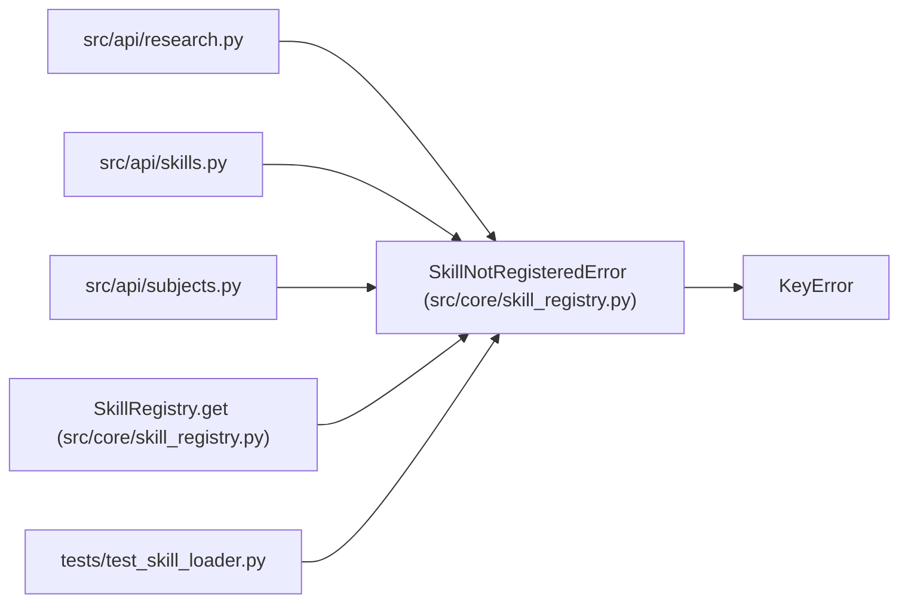

# SkillNotRegisteredError

**Location:** `src/core/skill_registry.py:56`
**Kind:** Class
**Bases:** `KeyError`
**Module:** [skill_registry](../modules/skill_registry.md)

## Description

Raised when a skill id is not present in the registry.

## Attributes

*No annotated attributes found.*

## Methods

| Method | Signature | Decorators | Description |
|--------|-----------|------------|-------------|
| `__init__` | `(skill_id: str, *, available: Iterable[str] = ()) -> None` | — | — |
| `__str__` | `() -> str` | — | — |

## Relationships

<!-- Auto-generated relationship summary. Do not edit by hand. -->

### Summary

| Module | Methods | Attributes |
|---|---:|---|
| [skill_registry](../modules/skill_registry.md) | 2 | — |

### Structure

| Kind | Entity | Module |
|---|---|---|
| Base | `KeyError` | — |

### References

| Reference | Kind | Source | Call sites |
|---|---|---|---:|
| `research` | import | [research](../modules/research.md) | — |
| `skills` | import | [src_api_skills](../modules/src_api_skills.md) | — |
| `subjects` | import | [subjects](../modules/subjects.md) | — |
| `SkillRegistry.get` | call | [skill_registry](../modules/skill_registry.md) | 1 |
| `test_skill_loader` | import | [test_skill_loader](../modules/test_skill_loader.md) | — |
