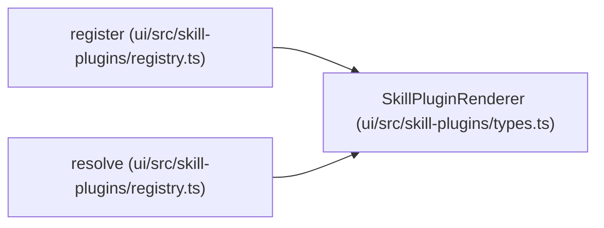

# SkillPluginRenderer

**Location:** `ui/src/skill-plugins/types.ts:33`
**Kind:** Class
**Bases:** —
**Module:** [types](../modules/types.md)

## Description

A renderer for one or more field types. Registered against the plugin
registry; the first renderer whose `canRender` returns true wins.

## Attributes

| Name | Type | Required | Default | Description |
|------|------|----------|---------|-------------|
| `id` | `string` | Yes | — | — |
| `canRender` | `(field: FormField) => boolean` | Yes | — | — |
| `render` | `(props: SkillPluginRendererProps) => ReactNode` | Yes | — | — |

## Methods

*No public methods. Inherits from base classes.*

## Relationships

<!-- Auto-generated relationship summary. Do not edit by hand. -->

### Summary

| Module | Methods | Attributes |
|---|---:|---|
| [types](../modules/types.md) | 0 | `canRender`, `id`, `render` |

### References

| Reference | Kind | Source | Call sites |
|---|---|---|---:|
| `register` | type_reference | [registry](../modules/registry.md) | — |
| `resolve` | type_reference | [registry](../modules/registry.md) | — |
