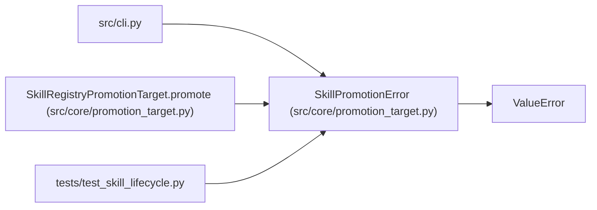

# SkillPromotionError

**Location:** `src/core/promotion_target.py:607`
**Kind:** Class
**Bases:** `ValueError`
**Module:** [promotion_target](../modules/promotion_target.md)

## Description

Raised when a skill promotion precondition fails (P5-011).

## Attributes

*No annotated attributes found.*

## Methods

*No public methods. Inherits from base classes.*

## Relationships

<!-- Auto-generated relationship summary. Do not edit by hand. -->

### Summary

| Module | Methods | Attributes |
|---|---:|---|
| [promotion_target](../modules/promotion_target.md) | 0 | — |

### Structure

| Kind | Entity | Module |
|---|---|---|
| Base | `ValueError` | — |

### References

| Reference | Kind | Source | Call sites |
|---|---|---|---:|
| `cli` | import | [cli](../modules/cli.md) | — |
| `SkillRegistryPromotionTarget.promote` | call | [promotion_target](../modules/promotion_target.md) | 3 |
| `test_skill_lifecycle` | import | [test_skill_lifecycle](../modules/test_skill_lifecycle.md) | — |
