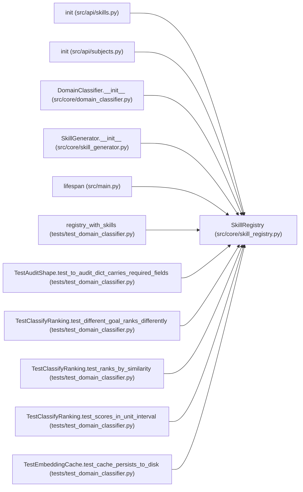

# SkillRegistry

**Location:** `src/core/skill_registry.py:69`
**Kind:** Class
**Bases:** —
**Module:** [skill_registry](../modules/skill_registry.md)

## Description

Discovers, caches, and serves ``research_skill.v1`` manifests.

Parameters
----------
root:
    Directory to scan for ``skills/<id>/SKILL.yaml``. Defaults to
    ``DEFAULT_SKILLS_ROOT`` (the service's ``skills/`` dir).
settings_obj:
    Forwarded to ``load_skill_manifest`` for ``{settings.*}`` interpolation
    (G6). Defaults to ``None`` (loader falls back to ``src.config.settings``).

## Attributes

*No annotated attributes found.*

## Methods

| Method | Signature | Decorators | Description |
|--------|-----------|------------|-------------|
| `__init__` | `(*, root: Optional[Path] = None, settings_obj: Any = None) -> None` | — | — |
| `discover` | `() -> list[str]` | — | Scan ``root`` for skill packages and return their ids (sorted). |
| `discover_drafts` | `() -> list[str]` | — | Enumerate generator drafts under ``skills/_drafts/<id>/`` (P5-023). |
| `drafts_root` | `() -> Path` | `@property` | Absolute path of the ``skills/_drafts/`` directory (created lazily). |
| `available` | `() -> list[str]` | — | Ids known to the registry (scans once, then caches the listing). |
| `register_path` | `(skill_id: str, manifest_path: Path) -> None` | — | Register a manifest by explicit path (used by tests / non-standard |
| `get` | `(skill_id: str) -> ResearchSkillManifest` | — | Return the validated manifest for ``skill_id``, loading/reloading as |
| `_load` | `(path: Path) -> ResearchSkillManifest` | — | — |
| `reload_all` | `() -> int` | — | Force-reload every cached manifest. Returns the count reloaded. |

## Relationships

<!-- Auto-generated relationship summary. Do not edit by hand. -->

### Summary

| Module | Methods | Attributes |
|---|---:|---|
| [skill_registry](../modules/skill_registry.md) | 9 | — |

### References

| Reference | Kind | Source | Call sites |
|---|---|---|---:|
| `init` | type_reference | [src_api_skills](../modules/src_api_skills.md) | — |
| `init` | type_reference | [subjects](../modules/subjects.md) | — |
| `DomainClassifier.__init__` | type_reference | [domain_classifier](../modules/domain_classifier.md) | — |
| `SkillGenerator.__init__` | type_reference | [skill_generator](../modules/skill_generator.md) | — |
| `lifespan` | call | [src_main](../modules/src_main.md) | 1 |
| `registry_with_skills` | call | [test_domain_classifier](../modules/test_domain_classifier.md) | 1 |
| `registry_with_skills` | type_reference | [test_domain_classifier](../modules/test_domain_classifier.md) | — |
| `TestAuditShape.test_to_audit_dict_carries_required_fields` | type_reference | [test_domain_classifier](../modules/test_domain_classifier.md) | — |
| `TestClassifyRanking.test_different_goal_ranks_differently` | type_reference | [test_domain_classifier](../modules/test_domain_classifier.md) | — |
| `TestClassifyRanking.test_ranks_by_similarity` | type_reference | [test_domain_classifier](../modules/test_domain_classifier.md) | — |
| `TestClassifyRanking.test_scores_in_unit_interval` | type_reference | [test_domain_classifier](../modules/test_domain_classifier.md) | — |
| `TestEmbeddingCache.test_cache_persists_to_disk` | type_reference | [test_domain_classifier](../modules/test_domain_classifier.md) | — |

> References: showing 12 of 33 logical references; 21 omitted by the 12-row generated summary limit.
