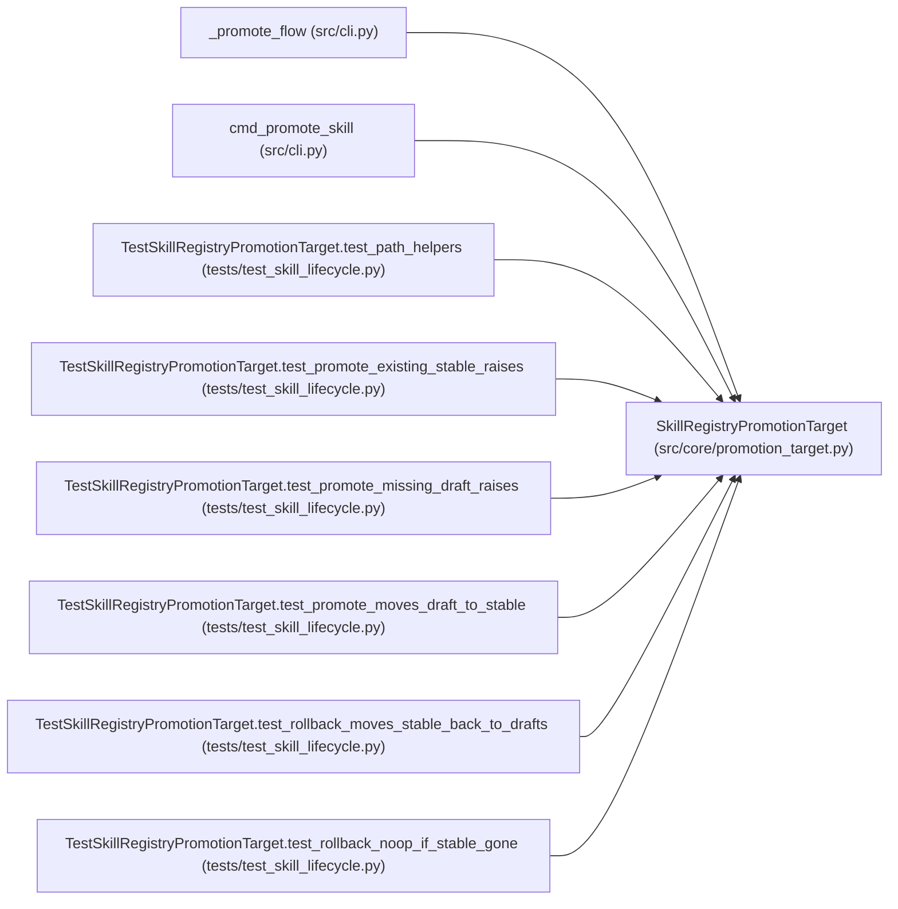

# SkillRegistryPromotionTarget

**Location:** `src/core/promotion_target.py:509`
**Kind:** Class
**Bases:** —
**Module:** [promotion_target](../modules/promotion_target.md)

## Description

Promote a draft skill into the live registry (ARC-011 P5-011).

The Phase-1 ``PromotionTarget`` protocol is a *file-write* surface for config
promotion; skill promotion is a different shape (a directory move +
lifecycle transition), so this target does NOT implement that protocol.
Instead it is consumed directly by the ``POST /skills/{id}/promote/confirm``
endpoint (P5-012), which orchestrates the move + lifecycle update + audit.

The move is atomic per skill: ``skills/_drafts/<id>/`` → ``skills/<id>/``
via ``shutil.move`` (a rename when on the same filesystem, else a copy
tree). The caller wraps this in the lifecycle machine's per-skill lock and
writes the audit row from the returned ``SkillPromotionResult``.

Reuses the P0-020 production-approval machinery: skill → stable is a
production-scope act (X-004 D1 — production sessions require ``stable``), so
the API endpoint gate-keeps the approval signature before calling this.

## Attributes

*No annotated attributes found.*

## Methods

| Method | Signature | Decorators | Description |
|--------|-----------|------------|-------------|
| `__init__` | `(*, skills_root: Optional[Path] = None) -> None` | — | — |
| `draft_path` | `(skill_id: str) -> Path` | — | — |
| `stable_path` | `(skill_id: str) -> Path` | — | — |
| `draft_exists` | `(skill_id: str) -> bool` | — | — |
| `stable_exists` | `(skill_id: str) -> bool` | — | — |
| `promote` | *(async)* `(skill_id: str) -> 'SkillPromotionResult'` | — | Move ``skills/_drafts/<id>/`` → ``skills/<id>/`` atomically. |
| `rollback` | *(async)* `(skill_id: str) -> None` | — | Best-effort move a just-promoted skill back to ``_drafts/``. |

## Relationships

<!-- Auto-generated relationship summary. Do not edit by hand. -->

### Summary

| Module | Methods | Attributes |
|---|---:|---|
| [promotion_target](../modules/promotion_target.md) | 7 | — |

### References

| Reference | Kind | Source | Call sites |
|---|---|---|---:|
| `_promote_flow` | call | [cli](../modules/cli.md) | 1 |
| `cmd_promote_skill` | call | [cli](../modules/cli.md) | 1 |
| `TestSkillRegistryPromotionTarget.test_path_helpers` | call | [test_skill_lifecycle](../modules/test_skill_lifecycle.md) | 1 |
| `TestSkillRegistryPromotionTarget.test_promote_existing_stable_raises` | call | [test_skill_lifecycle](../modules/test_skill_lifecycle.md) | 1 |
| `TestSkillRegistryPromotionTarget.test_promote_missing_draft_raises` | call | [test_skill_lifecycle](../modules/test_skill_lifecycle.md) | 1 |
| `TestSkillRegistryPromotionTarget.test_promote_moves_draft_to_stable` | call | [test_skill_lifecycle](../modules/test_skill_lifecycle.md) | 1 |
| `TestSkillRegistryPromotionTarget.test_rollback_moves_stable_back_to_drafts` | call | [test_skill_lifecycle](../modules/test_skill_lifecycle.md) | 1 |
| `TestSkillRegistryPromotionTarget.test_rollback_noop_if_stable_gone` | call | [test_skill_lifecycle](../modules/test_skill_lifecycle.md) | 1 |
