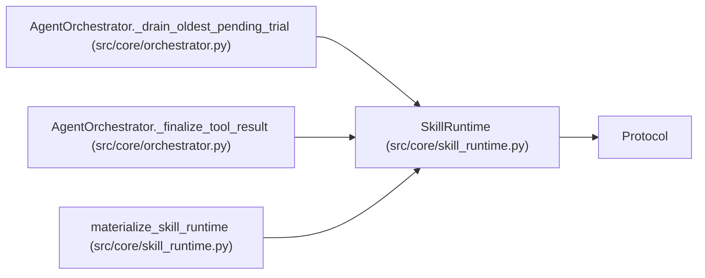

# SkillRuntime

**Location:** `src/core/skill_runtime.py:184`
**Kind:** Class
**Bases:** `Protocol`
**Module:** [skill_runtime](../modules/skill_runtime.md)

## Description

Contract every research skill implements (ARC-011 P1-023, §7.5).

Materialized once per session. All methods are deterministic and
side-effect-free unless documented otherwise; the orchestrator owns
persistence, audit, and execution. The three transitional implementations
(P1-024..026) delegate to the current hardcoded code paths — behavior is
identical, just relocated out of the orchestrator's ``if config.model_type``
branches.

## Attributes

*No annotated attributes found.*

## Methods

| Method | Signature | Decorators | Description |
|--------|-----------|------------|-------------|
| `skill_id` | `() -> str` | `@property` | — |
| `skill_version` | `() -> str` | `@property` | — |
| `system_prompt` | `() -> str` | — | — |
| `directive_prompt` | `(config: 'ResearchConfig') -> str` | — | — |
| `resume_prompt` | `(config: 'ResearchConfig', parent: SessionRecord, parent_iterations: list[IterationRecord]) -> str` | — | — |
| `command_policy_extension` | `() -> CommandPolicyExtension` | — | Allowed scripts/executables/copyable-files/readable-files that extend |
| `evaluator_command_params` | `(config: 'ResearchConfig') -> dict[str, str]` | — | Server-owned evaluator flags for execution-boundary enforcement. |
| `experiment_command` | `(config: 'ResearchConfig') -> str` | — | Session-resolved suggested experiment command. |
| `demo_experiment_command` | `(config: 'ResearchConfig') -> str` | — | The command the demo provider (MockProvider) executes verbatim in |
| `iteration_marker_prefix` | `() -> str` | — | The ``output_parser.iteration_marker`` prefix (default |
| `parse_iteration` | `(raw_output: str, *, session_nonce: Optional[bytes] = None, config_snapshot: Optional[str] = None) -> Optional[dict[str, Any]]` | — | Parse experiment output into a structured result. |
| `marker_file_paths` | `(config: 'ResearchConfig') -> list[Path]` | — | Fallback iteration sources (``last_metrics.txt``, ``results.json``). |
| `phase_plan` | `() -> list[Phase]` | — | — |
| `phase_advancement_rule` | `(phase_id: str) -> AdvancementRule` | — | — |
| `blocker_classification` | `() -> dict[str, Any]` | — | G3: per-skill blocker-classification overrides (ARC-011 review |
| `trial_identity` | `(config: 'ResearchConfig', *, command: str, config_snapshot: Optional[str] = None, planned_trial: Optional[dict] = None) -> dict` | — | — |
| `preflight_checks` | `() -> list['PreflightCheck']` | — | — |
| `execution_concurrency` | `() -> int` | — | Max independent trial commands the loop may run in parallel. |
| `promotion_target` | `() -> 'PromotionTarget'` | — | — |
| `output_parser` | `() -> 'OutputParser'` | — | The parser for ``---`` delimited prepare.py output. |
| `iteration_marker_parser` | `() -> 'OutputParser'` | — | The parser for ``ITERATION_RESULT:`` JSON-line markers. |
| `insights_prompt` | `(session: SessionRecord, iterations: list[IterationRecord]) -> str` | — | — |
| `research_resume_path` | `(config: 'ResearchConfig') -> Path` | — | — |
| `generate_research_resume` | `(config: 'ResearchConfig', store: 'StateStore') -> str` | — | — |
| `structured_hpo_plan` | `(config: 'ResearchConfig') -> Optional[StructuredHPOPlan]` | — | — |
| `list_subjects` | `() -> list[SubjectDescriptor]` | — | — |
| `list_variants` | `(subject_id: str) -> list[VariantDescriptor]` | — | — |

## Relationships

<!-- Auto-generated relationship summary. Do not edit by hand. -->

### Summary

| Module | Methods | Attributes |
|---|---:|---|
| [skill_runtime](../modules/skill_runtime.md) | 27 | — |

### Structure

| Kind | Entity | Module |
|---|---|---|
| Base | `Protocol` | — |

### References

| Reference | Kind | Source | Call sites |
|---|---|---|---:|
| `AgentOrchestrator._drain_oldest_pending_trial` | type_reference | [orchestrator](../modules/orchestrator.md) | — |
| `AgentOrchestrator._finalize_tool_result` | type_reference | [orchestrator](../modules/orchestrator.md) | — |
| `materialize_skill_runtime` | type_reference | [skill_runtime](../modules/skill_runtime.md) | — |
