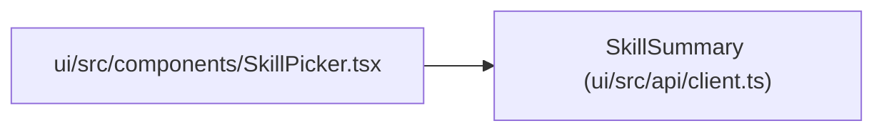

# SkillSummary

**Location:** `ui/src/api/client.ts:459`
**Kind:** Class
**Bases:** —
**Module:** [client](../modules/client.md)

## Description

_Auto-generated from `SkillSummary` in `ui/src/api/client.ts`._

## Attributes

| Name | Type | Required | Default | Description |
|------|------|----------|---------|-------------|
| `id` | `string` | Yes | — | — |
| `version` | `string` | Yes | — | — |
| `category` | `string` | Yes | — | — |
| `display_name` | `string` | Yes | — | — |
| `description` | `string` | Yes | — | — |
| `schema_version` | `string` | Yes | — | — |
| `model_type` | `string` | Yes | — | — |
| `has_subjects` | `boolean` | Yes | — | — |
| `has_variants` | `boolean` | Yes | — | — |

## Methods

*No public methods. Inherits from base classes.*

## Relationships

<!-- Auto-generated relationship summary. Do not edit by hand. -->

### Summary

| Module | Methods | Attributes |
|---|---:|---|
| [client](../modules/client.md) | 0 | `category`, `description`, `display_name`, `has_subjects`, `has_variants`, `id`, `model_type`, `schema_version`, `version` |

### References

| Reference | Kind | Source | Call sites |
|---|---|---|---:|
| `SkillPicker` | import | [SkillPicker](../modules/SkillPicker.md) | — |
