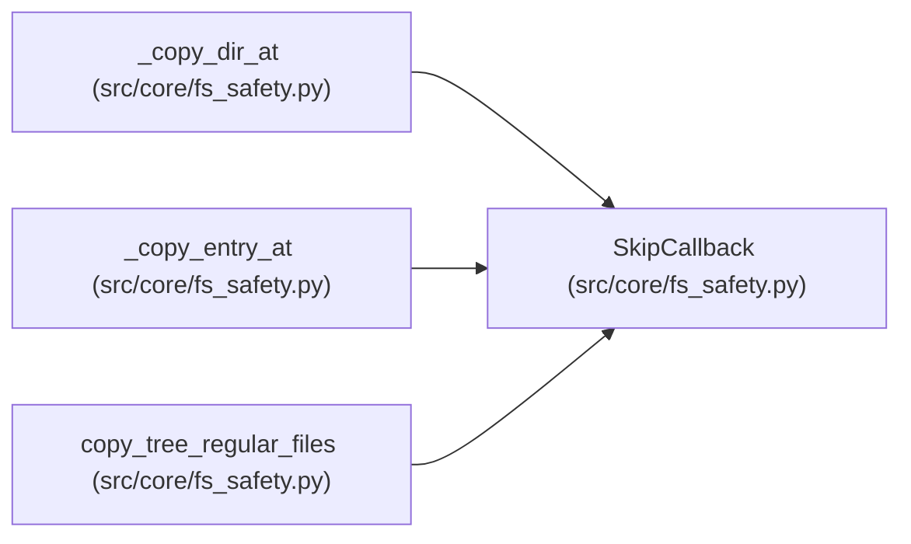

# SkipCallback

**Location:** `src/core/fs_safety.py:46`
**Kind:** Type alias
**Bases:** —
**Module:** [fs_safety](../modules/fs_safety.md)
**Target:** `Callable[[str, str], None]`

## Description

_Auto-generated from `SkipCallback` in `src/core/fs_safety.py`._

## Attributes

*No annotated attributes found.*

## Methods

*No public methods. Inherits from base classes.*

## Relationships

<!-- Auto-generated relationship summary. Do not edit by hand. -->

### Summary

| Module | Methods | Attributes |
|---|---:|---|
| [fs_safety](../modules/fs_safety.md) | 0 | — |

### References

| Reference | Kind | Source | Call sites |
|---|---|---|---:|
| `_copy_dir_at` | type_reference | [fs_safety](../modules/fs_safety.md) | — |
| `_copy_entry_at` | type_reference | [fs_safety](../modules/fs_safety.md) | — |
| `copy_tree_regular_files` | type_reference | [fs_safety](../modules/fs_safety.md) | — |
