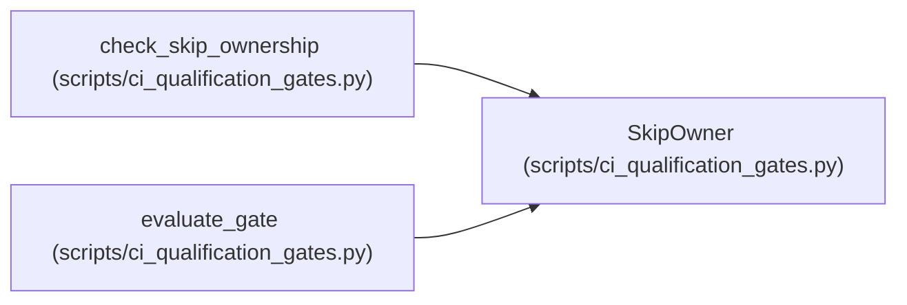

# SkipOwner

**Location:** `scripts/ci_qualification_gates.py:41`
**Kind:** Class
**Bases:** —
**Module:** [ci_qualification_gates](../modules/ci_qualification_gates.md)

**Decorators:** `@dataclass(frozen=True)`

## Description

_Auto-generated from `SkipOwner` in `scripts/ci_qualification_gates.py`._

## Attributes

| Name | Type | Default | Description |
|------|------|---------|-------------|
| `pattern` | `str` | *required* | — |
| `owner` | `str` | *required* | — |
| `reason` | `str` | *required* | — |

## Methods

*No public methods. Inherits from base classes.*

## Relationships

<!-- Auto-generated relationship summary. Do not edit by hand. -->

### Summary

| Module | Methods | Attributes |
|---|---:|---|
| [ci_qualification_gates](../modules/ci_qualification_gates.md) | 0 | `owner`, `pattern`, `reason` |

### References

| Reference | Kind | Source | Call sites |
|---|---|---|---:|
| `check_skip_ownership` | type_reference | [ci_qualification_gates](../modules/ci_qualification_gates.md) | — |
| `evaluate_gate` | type_reference | [ci_qualification_gates](../modules/ci_qualification_gates.md) | — |
