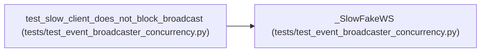

# _SlowFakeWS

**Location:** `tests/test_event_broadcaster_concurrency.py:56`
**Kind:** Class
**Bases:** —
**Module:** [test_event_broadcaster_concurrency](../modules/test_event_broadcaster_concurrency.md)

## Description

A fake WebSocket whose ``send_text`` blocks past the send timeout.

## Attributes

*No annotated attributes found.*

## Methods

| Method | Signature | Decorators | Description |
|--------|-----------|------------|-------------|
| `__init__` | `(*, delay: float = 60.0) -> None` | — | — |
| `accept` | *(async)* `(*, subprotocol: str \| None = None) -> None` | — | — |
| `close` | *(async)* `(*, code: int = 1000) -> None` | — | — |
| `send_text` | *(async)* `(payload: str) -> None` | — | — |

## Relationships

<!-- Auto-generated relationship summary. Do not edit by hand. -->

### Summary

| Module | Methods | Attributes |
|---|---:|---|
| [test_event_broadcaster_concurrency](../modules/test_event_broadcaster_concurrency.md) | 4 | — |

### References

| Reference | Kind | Source | Call sites |
|---|---|---|---:|
| `test_slow_client_does_not_block_broadcast` | call | [test_event_broadcaster_concurrency](../modules/test_event_broadcaster_concurrency.md) | 1 |
