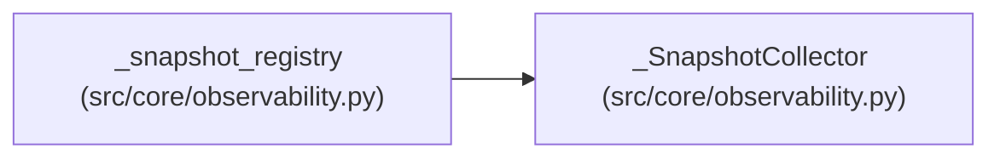

# _SnapshotCollector

**Location:** `src/core/observability.py:138`
**Kind:** Class
**Bases:** —
**Module:** [observability](../modules/observability.md)

## Description

_Auto-generated from `_SnapshotCollector` in `src/core/observability.py`._

## Attributes

*No annotated attributes found.*

## Methods

| Method | Signature | Decorators | Description |
|--------|-----------|------------|-------------|
| `__init__` | `(snapshot: Mapping[str, Any]) -> None` | — | — |
| `collect` | `() -> Iterable[Any]` | — | — |

## Relationships

<!-- Auto-generated relationship summary. Do not edit by hand. -->

### Summary

| Module | Methods | Attributes |
|---|---:|---|
| [observability](../modules/observability.md) | 2 | — |

### References

| Reference | Kind | Source | Call sites |
|---|---|---|---:|
| `_snapshot_registry` | call | [observability](../modules/observability.md) | 1 |
