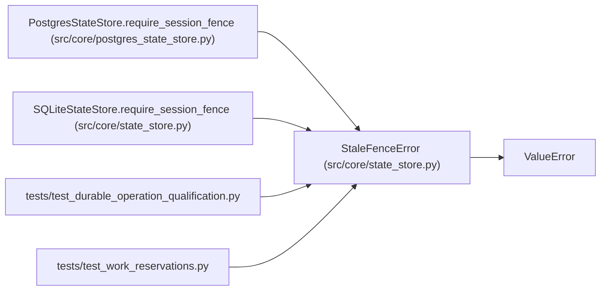

# StaleFenceError

**Location:** `src/core/state_store.py:996`
**Kind:** Class
**Bases:** `ValueError`
**Module:** [state_store](../modules/state_store.md)

## Description

Raised when a write carries a fence epoch older than the current one.

## Attributes

*No annotated attributes found.*

## Methods

*No public methods. Inherits from base classes.*

## Relationships

<!-- Auto-generated relationship summary. Do not edit by hand. -->

### Summary

| Module | Methods | Attributes |
|---|---:|---|
| [state_store](../modules/state_store.md) | 0 | — |

### Structure

| Kind | Entity | Module |
|---|---|---|
| Base | `ValueError` | — |

### References

| Reference | Kind | Source | Call sites |
|---|---|---|---:|
| `PostgresStateStore.require_session_fence` | call | [postgres_state_store](../modules/postgres_state_store.md) | 1 |
| `SQLiteStateStore.require_session_fence` | call | [state_store](../modules/state_store.md) | 1 |
| `test_durable_operation_qualification` | import | [test_durable_operation_qualification](../modules/test_durable_operation_qualification.md) | — |
| `test_work_reservations` | import | [test_work_reservations](../modules/test_work_reservations.md) | — |
