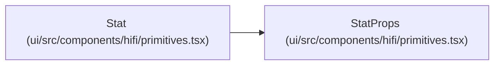

# StatProps

**Location:** `ui/src/components/hifi/primitives.tsx:105`
**Kind:** Class
**Bases:** —
**Module:** [primitives](../modules/primitives.md)

## Description

_Auto-generated from `StatProps` in `ui/src/components/hifi/primitives.tsx`._

## Attributes

| Name | Type | Required | Default | Description |
|------|------|----------|---------|-------------|
| `label` | `ReactNode` | Yes | — | — |
| `value` | `ReactNode` | Yes | — | — |
| `sub` | `ReactNode` | No | — | — |
| `delta` | `string` | No | — | — |
| `deltaDir` | `'up' \| 'dn' \| 'flat'` | No | — | — |
| `valueSize` | `'sm' \| 'lg'` | No | — | — |

## Methods

*No public methods. Inherits from base classes.*

## Relationships

<!-- Auto-generated relationship summary. Do not edit by hand. -->

### Summary

| Module | Methods | Attributes |
|---|---:|---|
| [primitives](../modules/primitives.md) | 0 | `delta`, `deltaDir`, `label`, `sub`, `value`, `valueSize` |

### References

| Reference | Kind | Source | Call sites |
|---|---|---|---:|
| `Stat` | type_reference | [primitives](../modules/primitives.md) | — |
