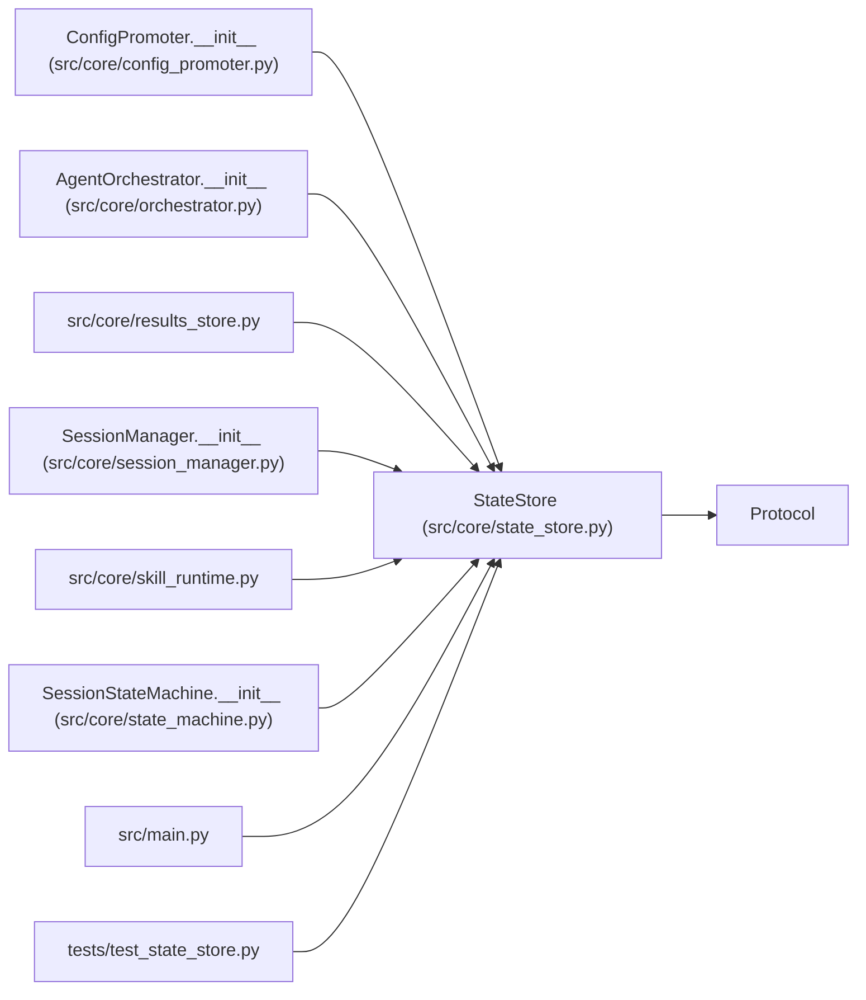

# StateStore

**Location:** `src/core/state_store.py:1000`
**Kind:** Class
**Bases:** `Protocol`
**Module:** [state_store](../modules/state_store.md)

## Description

Storage abstraction for research sessions, iterations, and promotions.

Every consumer (``SessionManager``, ``AgentOrchestrator``, the API layer)
reaches persistence through this protocol. ``SQLiteStateStore`` is the
single concrete implementation today; ``PostgresStateStore`` (P6-001/P6-002)
will satisfy the same surface.

**Not** ``@runtime_checkable`` (typing-time contract only; ``isinstance``
against a ``Protocol`` checks attribute presence, not signatures — see the
module docstring and the ``LLMProvider`` precedent).

``connection()`` is deliberately absent: it returns
``AsyncIterator[aiosqlite.Connection]`` and would leak the SQLite backend
type through the abstraction. No external consumer calls it.

## Attributes

*No annotated attributes found.*

## Methods

| Method | Signature | Decorators | Description |
|--------|-----------|------------|-------------|
| `initialize` | *(async)* `() -> None` | — | — |
| `close` | *(async)* `() -> None` | — | — |
| `ping` | *(async)* `() -> bool` | — | — |
| `get_schema_version` | *(async)* `() -> int` | — | — |
| `session_lock` | *(async)* `(session_id: str) -> AsyncIterator[None]` | `@asynccontextmanager` | Hold an exclusive lock on the session for the duration of the block. |
| `bump_session_epoch` | *(async)* `(session_id: str) -> None` | — | Increment the session's fencing epoch (ARC-011 P6-003 / D-fencing). |
| `begin_idempotency_record` | *(async)* `(*, operation: str, parent_id: str, key_hash: str, request_hash: str) -> Optional[Dict[str, Any]]` | — | — |
| `complete_idempotency_record` | *(async)* `(*, operation: str, parent_id: str, key_hash: str, child_id: Optional[str], response: Dict[str, Any]) -> None` | — | — |
| `delete_idempotency_record` | *(async)* `(*, operation: str, parent_id: str, key_hash: str) -> None` | — | — |
| `record_audit_event` | *(async)* `(*, actor_id: str, action: str, outcome: str, research_id: Optional[str] = None, pipeline_id: Optional[str] = None, request_metadata: Optional[Dict[str, Any]] = None, error_message: Optional[str] = None) -> Dict[str, Any]` | — | — |
| `list_audit_events` | *(async)* `(*, limit: int = 100, action: Optional[str] = None, research_id: Optional[str] = None, pipeline_id: Optional[str] = None) -> List[Dict[str, Any]]` | — | — |
| `create_session` | *(async)* `(*, session_id: str, instrument: str, timeframe: str, model_type: str, tag: str, quick_mode: bool, max_iterations: int, max_budget_usd: float, focus_hint: Optional[str], workspace_path: str, manifest_json: Optional[str] = None, manifest_path: Optional[str] = None, manifest_hash: Optional[str] = None, skill_id: Optional[str] = None, subject_id: Optional[str] = None, variant: Optional[str] = None, comparison_context: Optional[str] = None) -> Dict[str, Any]` | — | — |
| `get_session` | *(async)* `(session_id: str) -> Optional[Dict[str, Any]]` | — | — |
| `list_sessions` | *(async)* `(status: Optional[str] = None, model_type: Optional[str] = None, instrument: Optional[str] = None, status_in: Optional[Sequence[str]] = None, limit: Optional[int] = None, offset: int = 0, cursor: Optional[tuple[Any, int]] = None, reverse: bool = False) -> List[Dict[str, Any]]` | — | — |
| `count_sessions` | *(async)* `(status: Optional[str] = None, model_type: Optional[str] = None, instrument: Optional[str] = None, status_in: Optional[Sequence[str]] = None) -> int` | — | — |
| `update_session` | *(async)* `(session_id: str, *, lock_epoch: Optional[int] = None, **fields: Any) -> Optional[Dict[str, Any]]` | — | — |
| `delete_session` | *(async)* `(session_id: str) -> bool` | — | — |
| `record_runtime_command` | *(async)* `(*, research_id: str, turn: Optional[int], tool_name: str, command: Optional[str] = None, normalized_command: Optional[str] = None, policy_operation: Optional[str] = None, timeout_s: Optional[int] = None, metadata: Optional[Dict[str, Any]] = None) -> Dict[str, Any]` | — | — |
| `finish_runtime_command` | *(async)* `(command_id: int, *, status: str, returncode: Optional[int] = None, timed_out: bool = False, output_preview: Optional[str] = None, error_message: Optional[str] = None, metadata: Optional[Dict[str, Any]] = None) -> Optional[Dict[str, Any]]` | — | — |
| `list_runtime_commands` | *(async)* `(*, research_id: Optional[str] = None, status: Optional[str] = None, command_id: Optional[int] = None) -> List[Dict[str, Any]]` | — | — |
| `interrupt_runtime_commands` | *(async)* `(*, research_id: str, reason: str) -> int` | — | — |
| `add_iteration` | *(async)* `(*, research_id: str, iteration: int, primary_metric: Optional[float], metric_name: Optional[str], all_gates_passed: Optional[bool], decision: Optional[str], description: Optional[str], config_snapshot: Optional[str], metrics_json: Optional[str], training_time_s: Optional[float], api_cost_usd: float = 0.0, mlflow_run_id: Optional[str] = None, canonical_config_hash: Optional[str] = None, trial_identity_hash: Optional[str] = None, trial_identity_json: Optional[str] = None, duplicate_of_research_id: Optional[str] = None, duplicate_of_iteration: Optional[int] = None, duplicate_reason: Optional[str] = None, attempt_snapshot_json: Optional[str] = None, attempt_snapshot_path: Optional[str] = None, attempt_snapshot_hash: Optional[str] = None, consistency_report_json: Optional[str] = None, search_phase: Optional[str] = None, metric_improvement_epsilon: float = 0.0, objective: Optional[ObjectiveComparator] = None, lock_epoch: Optional[int] = None) -> Dict[str, Any]` | — | — |
| `get_iterations` | *(async)* `(research_id: str, limit: Optional[int] = None, cursor: Optional[tuple[Any, int]] = None, reverse: bool = False) -> List[Dict[str, Any]]` | — | — |
| `get_cross_session_iteration_summary` | *(async)* `(*, instrument: str, timeframe: str, model_type: str, exclude_research_id: Optional[str] = None, limit: int = 500) -> List[Dict[str, Any]]` | — | — |
| `update_iteration` | *(async)* `(research_id: str, iteration: int, marker: Dict[str, Any]) -> None` | — | — |
| `get_iteration` | *(async)* `(research_id: str, iteration: int) -> Optional[Dict[str, Any]]` | — | — |
| `rank_leaderboard_groups` | *(async)* `(*, model_types: Sequence[str], direction: str = 'maximize', limit: int = 20, offset: int = 0) -> List[Dict[str, Any]]` | — | — |
| `rank_leaderboard_explain` | *(async)* `(*, model_types: Sequence[str]) -> str` | — | — |
| `get_best_iteration` | *(async)* `(research_id: str, *, objective: Optional[ObjectiveComparator] = None) -> Optional[Dict[str, Any]]` | — | — |
| `get_latest_iteration_with_config_snapshot` | *(async)* `(research_id: str) -> Optional[Dict[str, Any]]` | — | — |
| `get_first_iteration_with_config_snapshot` | *(async)* `(research_id: str) -> Optional[Dict[str, Any]]` | — | — |
| `find_duplicate_trial_identity` | *(async)* `(*, research_id: str, trial_identity_hash: str, instrument: str, timeframe: str, model_type: str, include_cross_session: bool = False) -> Optional[Dict[str, Any]]` | — | — |
| `add_hpo_study` | *(async)* `(*, research_id: str, iteration: int, n_trials: int, completed_trials: int, best_composite: Optional[float], training_time_s: Optional[float], top_trials_json: Optional[str], status: str = 'completed', study_id: Optional[str] = None, max_trials: Optional[int] = None, search_space_json: Optional[str] = None, budget_json: Optional[str] = None, timeout_s: Optional[int] = None, quick_mode: bool = False) -> Dict[str, Any]` | — | — |
| `record_hpo_study_plan` | *(async)* `(*, research_id: str, study_id: str, max_trials: int, search_space_json: str, budget_json: str, timeout_s: int, quick_mode: bool) -> Dict[str, Any]` | — | — |
| `get_hpo_studies` | *(async)* `(research_id: str) -> List[Dict[str, Any]]` | — | — |
| `record_planned_trials` | *(async)* `(*, research_id: str, study_id: Optional[str], trials: List[Dict[str, Any]]) -> List[Dict[str, Any]]` | — | — |
| `record_planned_trial_manual_review` | *(async)* `(*, research_id: str, study_id: Optional[str], expected_command: str, reason: str, search_phase: str = 'manual_review', config_patch: Optional[Dict[str, Any]] = None) -> Dict[str, Any]` | — | — |
| `get_planned_trials` | *(async)* `(research_id: str) -> List[Dict[str, Any]]` | — | — |
| `get_planned_trial` | *(async)* `(research_id: str, trial_id: str) -> Optional[Dict[str, Any]]` | — | — |
| `get_planned_trial_for_command` | *(async)* `(research_id: str, expected_command: str) -> Optional[Dict[str, Any]]` | — | — |
| `update_planned_trial_status` | *(async)* `(*, research_id: str, trial_id: str, status: str, result_path: Optional[str] = None, mlflow_run_id: Optional[str] = None, manual_review_reason: Optional[str] = None, train_config_path: Optional[str] = None, canonical_config_hash: Optional[str] = None, trial_identity_hash: Optional[str] = None, trial_identity: Optional[Dict[str, Any]] = None, trial_identity_json: Optional[str] = None) -> Optional[Dict[str, Any]]` | — | — |
| `record_promotion` | *(async)* `(*, research_id: str, iteration: int, model_type: str, instrument: str, timeframe: str, target_path: str, config_yaml: str, previous_yaml: Optional[str], scope: str = 'development', metadata_path: Optional[str] = None, promotion_metadata: Optional[Dict[str, Any]] = None, lock_epoch: Optional[int] = None) -> Dict[str, Any]` | — | — |
| `list_promotions` | *(async)* `() -> List[Dict[str, Any]]` | — | — |
| `get_latest_development_promotion` | *(async)* `(*, model_type: str, instrument: str, timeframe: str) -> Optional[Dict[str, Any]]` | — | — |
| `get_latest_promotion` | *(async)* `(*, model_type: str, instrument: str, timeframe: str, scope: str) -> Optional[Dict[str, Any]]` | — | — |
| `require_session_fence` | *(async)* `(session_id: str, lock_epoch: Optional[int]) -> None` | — | — |
| `record_usage_event` | *(async)* `(event: Mapping[str, Any]) -> bool` | — | — |
| `get_usage_events` | *(async)* `(research_id: str) -> List[Dict[str, Any]]` | — | — |
| `reserve_budget` | *(async)* `(*, reservation_id: str, research_id: str, amount_usd: float, strict_cap_usd: Optional[float], enforcement: str, lease_seconds: float = 300.0) -> Dict[str, Any]` | — | — |
| `reconcile_budget_reservation` | *(async)* `(reservation_id: str, *, actual_usd: float) -> Optional[Dict[str, Any]]` | — | — |
| `release_budget_reservation` | *(async)* `(reservation_id: str) -> bool` | — | — |
| `list_budget_reservations` | *(async)* `(research_id: Optional[str] = None) -> List[Dict[str, Any]]` | — | — |
| `append_event` | *(async)* `(*, event_id: str, stream_key: str, event_type: str, payload: Mapping[str, Any], producer: str, ownership_epoch: Optional[int] = None, attempt: Optional[int] = None, redacted: bool = False) -> Dict[str, Any]` | — | — |
| `list_events` | *(async)* `(*, stream_key: Optional[str] = None, after_sequence: int = 0, limit: int = 200) -> List[Dict[str, Any]]` | — | — |
| `event_cursor` | *(async)* `(stream_key: Optional[str] = None) -> int` | — | — |
| `min_event_cursor` | *(async)* `(stream_key: Optional[str] = None) -> int` | — | — |
| `record_state_event` | *(async)* `(session_id: str, *, fields: Mapping[str, Any], event_id: str, event_type: str, payload: Mapping[str, Any], producer: str, attempt: Optional[int] = None) -> Dict[str, Any]` | — | — |
| `reserve_work` | *(async)* `(*, reservation_key: str, scope_key: str, owner_id: str, capacity_limit: int, lease_seconds: float = 300.0) -> Dict[str, Any]` | — | — |
| `commit_work` | *(async)* `(*, reservation_key: str, research_id: str) -> Optional[Dict[str, Any]]` | — | — |
| `release_work` | *(async)* `(reservation_key: str) -> bool` | — | — |
| `renew_work_lease` | *(async)* `(*, reservation_key: str, owner_id: str, lease_seconds: float) -> bool` | — | — |
| `reclaim_expired_reservations` | *(async)* `() -> List[Dict[str, Any]]` | — | — |
| `get_work_reservation` | *(async)* `(reservation_key: str) -> Optional[Dict[str, Any]]` | — | — |
| `add_secret_ref` | *(async)* `(*, research_id: str, param_name: str, env_var: str, rebind_policy: str) -> None` | — | — |
| `get_secret_refs` | *(async)* `(research_id: str) -> List[Dict[str, Any]]` | — | — |
| `update_promotion_metadata` | *(async)* `(*, promotion_id: int, promotion_metadata: Dict[str, Any], lock_epoch: Optional[int] = None) -> Optional[Dict[str, Any]]` | — | — |
| `record_promotion_rollback` | *(async)* `(*, promotion_id: int, rollback_metadata_path: str, rollback_metadata: Dict[str, Any]) -> Optional[Dict[str, Any]]` | — | — |
| `create_pipeline` | *(async)* `(*, pipeline_id: str, instrument: str, timeframe: str, tag: str, max_iterations: int, max_budget_usd: float, quick_mode: bool, timeout_s: int, focus_hint: Optional[str], phase_budgets: Optional[str], trading_mode: Optional[str], agent_strategy: Optional[str], initial_balance: Optional[float], enable_hpo: bool, hpo_trials: Optional[int], hpo_timesteps: Optional[int]) -> Dict[str, Any]` | — | — |
| `get_pipeline` | *(async)* `(pipeline_id: str) -> Optional[Dict[str, Any]]` | — | — |
| `list_pipelines` | *(async)* `(status: Optional[str] = None, instrument: Optional[str] = None, limit: Optional[int] = None, offset: int = 0, cursor: Optional[tuple[Any, int]] = None, reverse: bool = False) -> List[Dict[str, Any]]` | — | — |
| `count_pipelines` | *(async)* `(status: Optional[str] = None, instrument: Optional[str] = None) -> int` | — | — |
| `update_pipeline` | *(async)* `(pipeline_id: str, **fields: Any) -> Optional[Dict[str, Any]]` | — | — |
| `collect_observability_metrics` | *(async)* `(*, active_sessions: int = 0) -> Dict[str, Any]` | — | — |

## Relationships

<!-- Auto-generated relationship summary. Do not edit by hand. -->

### Summary

| Module | Methods | Attributes |
|---|---:|---|
| [state_store](../modules/state_store.md) | 73 | — |

### Structure

| Kind | Entity | Module |
|---|---|---|
| Base | `Protocol` | — |

### References

| Reference | Kind | Source | Call sites |
|---|---|---|---:|
| `ConfigPromoter.__init__` | type_reference | [config_promoter](../modules/config_promoter.md) | — |
| `AgentOrchestrator.__init__` | type_reference | [orchestrator](../modules/orchestrator.md) | — |
| `results_store` | import | [results_store](../modules/results_store.md) | — |
| `SessionManager.__init__` | type_reference | [session_manager](../modules/session_manager.md) | — |
| `skill_runtime` | import | [skill_runtime](../modules/skill_runtime.md) | — |
| `SessionStateMachine.__init__` | type_reference | [state_machine](../modules/state_machine.md) | — |
| `main` | import | [src_main](../modules/src_main.md) | — |
| `test_state_store` | import | [test_state_store](../modules/test_state_store.md) | — |
