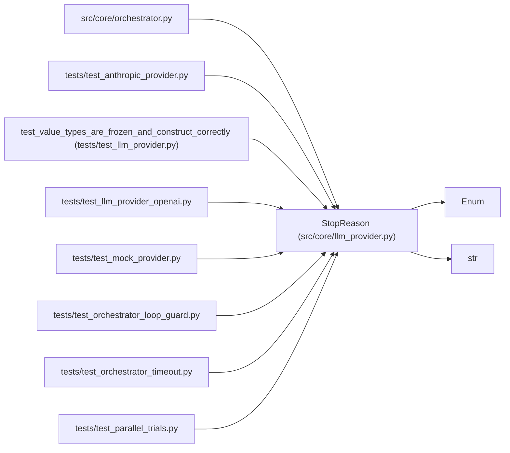

# StopReason

**Location:** `src/core/llm_provider.py:120`
**Kind:** Enum
**Bases:** `str`, `Enum`
**Module:** [llm_provider](../modules/llm_provider.md)

## Description

Normalized reason the model stopped generating (R5-critical).

Provider mapping (spike §3.3 / §5):

* Anthropic ``end_turn`` / OpenAI ``stop`` / Gemini ``STOP`` → ``END_TURN``
* ``tool_use`` / OpenAI ``tool_calls`` / function-calls-present → ``TOOL_USE``
* ``max_tokens`` / OpenAI ``length`` / Gemini ``MAX_TOKENS`` → ``MAX_TOKENS``
* ``stop_sequence`` → ``STOP_SEQUENCE``
* anything else (``pause_turn``, ``refusal``, ``content_filter``, …) → ``OTHER``

R5 invariant: a provider MUST return ``TOOL_USE`` whenever the response
carries tool/function calls, even if the native ``finish_reason`` says
``STOP`` (Gemini quirk). The loop keys off ``END_TURN`` for phase
continuation (``orchestrator.py`` ``run``).

## Attributes

| Name | Declared value | Description |
|------|-------|-------------|
| `END_TURN` | `'end_turn'` | — |
| `TOOL_USE` | `'tool_use'` | — |
| `MAX_TOKENS` | `'max_tokens'` | — |
| `STOP_SEQUENCE` | `'stop_sequence'` | — |
| `OTHER` | `'other'` | — |

## Methods

*No public methods. Inherits from base classes.*

## Relationships

<!-- Auto-generated relationship summary. Do not edit by hand. -->

### Summary

| Module | Methods | Attributes |
|---|---:|---|
| [llm_provider](../modules/llm_provider.md) | 0 | `END_TURN`, `MAX_TOKENS`, `OTHER`, `STOP_SEQUENCE`, `TOOL_USE` |

### Structure

| Kind | Entity | Module |
|---|---|---|
| Base | `Enum` | — |
| Base | `str` | — |

### References

| Reference | Kind | Source | Call sites |
|---|---|---|---:|
| `orchestrator` | import | [orchestrator](../modules/orchestrator.md) | — |
| `test_anthropic_provider` | import | [test_anthropic_provider](../modules/test_anthropic_provider.md) | — |
| `test_value_types_are_frozen_and_construct_correctly` | type_reference | [test_llm_provider](../modules/test_llm_provider.md) | — |
| `test_llm_provider_openai` | import | [test_llm_provider_openai](../modules/test_llm_provider_openai.md) | — |
| `test_mock_provider` | import | [test_mock_provider](../modules/test_mock_provider.md) | — |
| `test_orchestrator_loop_guard` | import | [test_orchestrator_loop_guard](../modules/test_orchestrator_loop_guard.md) | — |
| `test_orchestrator_timeout` | import | [test_orchestrator_timeout](../modules/test_orchestrator_timeout.md) | — |
| `test_parallel_trials` | import | [test_parallel_trials](../modules/test_parallel_trials.md) | — |
