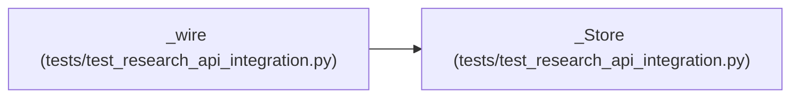

# _Store

**Location:** `tests/test_research_api_integration.py:43`
**Kind:** Class
**Bases:** —
**Module:** [test_research_api_integration](../modules/test_research_api_integration.md)

## Description

Minimal store stub with the session + iteration read surface.

## Attributes

*No annotated attributes found.*

## Methods

| Method | Signature | Decorators | Description |
|--------|-----------|------------|-------------|
| `__init__` | `() -> None` | — | — |
| `ping` | *(async)* `() -> bool` | — | — |
| `record_audit_event` | *(async)* `(**kwargs: Any) -> None` | — | — |
| `get_session` | *(async)* `(research_id: str) -> Dict[str, Any] \| None` | — | — |
| `get_iterations` | *(async)* `(research_id: str, *, limit: int \| None = None, cursor: tuple \| None = None) -> list[Dict[str, Any]]` | — | — |

## Relationships

<!-- Auto-generated relationship summary. Do not edit by hand. -->

### Summary

| Module | Methods | Attributes |
|---|---:|---|
| [test_research_api_integration](../modules/test_research_api_integration.md) | 5 | — |

### References

| Reference | Kind | Source | Call sites |
|---|---|---|---:|
| `_wire` | call | [test_research_api_integration](../modules/test_research_api_integration.md) | 1 |
