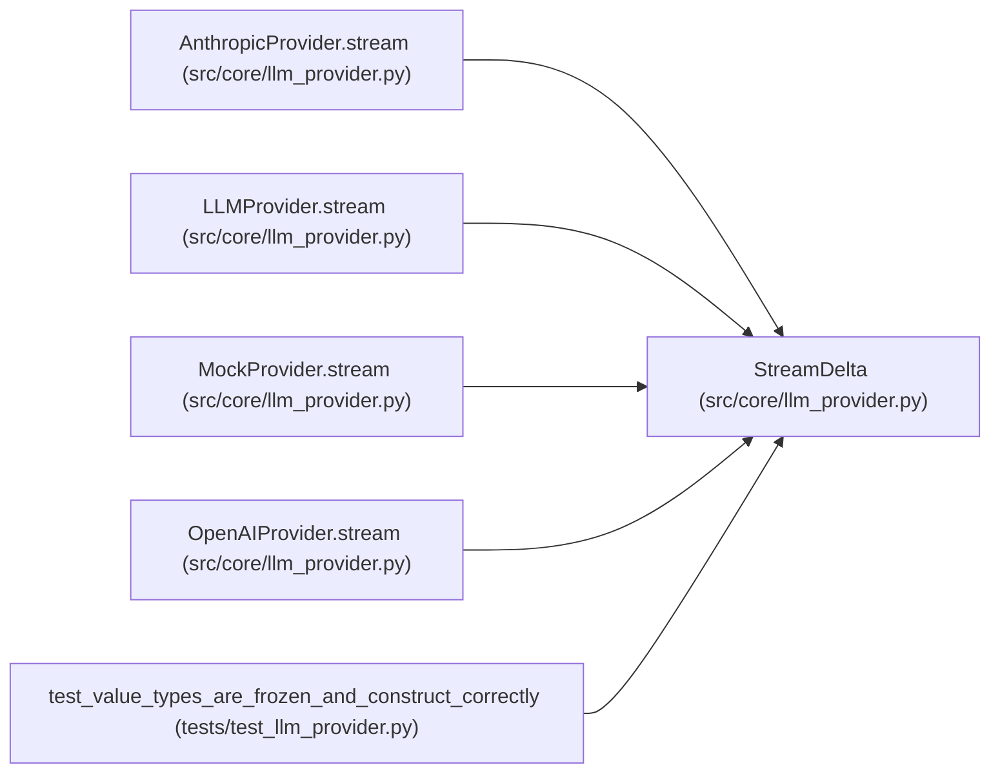

# StreamDelta

**Location:** `src/core/llm_provider.py:293`
**Kind:** Class
**Bases:** —
**Module:** [llm_provider](../modules/llm_provider.md)

**Decorators:** `@dataclass(frozen=True)`

## Description

One incremental chunk from ``stream()`` (completion #3).

The spike declared ``stream() -> AsyncIterator[StreamDelta]`` but did not
define ``StreamDelta``. These three fields are the minimal surface any token
consumer needs: partial text, an optional terminal ``stop_reason`` on the
final delta, and an optional terminal ``usage``.

## Attributes

| Name | Type | Default | Description |
|------|------|---------|-------------|
| `text` | `str` | `''` | — |
| `stop_reason` | `StopReason \| None` | `None` | — |
| `usage` | `Usage \| None` | `None` | — |

## Methods

*No public methods. Inherits from base classes.*

## Relationships

<!-- Auto-generated relationship summary. Do not edit by hand. -->

### Summary

| Module | Methods | Attributes |
|---|---:|---|
| [llm_provider](../modules/llm_provider.md) | 0 | `stop_reason`, `text`, `usage` |

### References

| Reference | Kind | Source | Call sites |
|---|---|---|---:|
| `AnthropicProvider.stream` | call | [llm_provider](../modules/llm_provider.md) | 1 |
| `AnthropicProvider.stream` | type_reference | [llm_provider](../modules/llm_provider.md) | — |
| `LLMProvider.stream` | call | [llm_provider](../modules/llm_provider.md) | 1 |
| `LLMProvider.stream` | type_reference | [llm_provider](../modules/llm_provider.md) | — |
| `MockProvider.stream` | call | [llm_provider](../modules/llm_provider.md) | 1 |
| `MockProvider.stream` | type_reference | [llm_provider](../modules/llm_provider.md) | — |
| `OpenAIProvider.stream` | call | [llm_provider](../modules/llm_provider.md) | 1 |
| `OpenAIProvider.stream` | type_reference | [llm_provider](../modules/llm_provider.md) | — |
| `test_value_types_are_frozen_and_construct_correctly` | type_reference | [test_llm_provider](../modules/test_llm_provider.md) | — |
