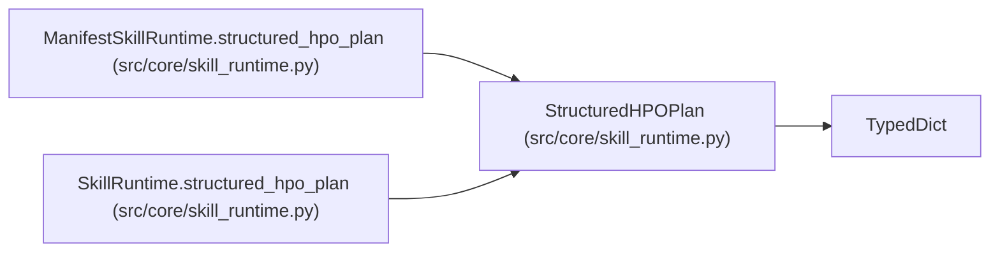

# StructuredHPOPlan

**Location:** `src/core/skill_runtime.py:164`
**Kind:** Class
**Bases:** `TypedDict`
**Module:** [skill_runtime](../modules/skill_runtime.md)

## Description

Alias over the HPO plan dict ``structured_hpo.build_structured_hpo_plan``
returns: ``schema_version``, ``research_id``, ``study_id``, ``model_type``,
``instrument``, ``timeframe``, ``enabled``, ``status``, ``created_at``,
``max_trials``, ``timeout_s``, ``quick_mode``, ``budget``, ``search_space``,
``execution``, ``trials``, ``plan_hash``.

## Attributes

*No annotated attributes found.*

## Methods

*No public methods. Inherits from base classes.*

## Relationships

<!-- Auto-generated relationship summary. Do not edit by hand. -->

### Summary

| Module | Methods | Attributes |
|---|---:|---|
| [skill_runtime](../modules/skill_runtime.md) | 0 | — |

### Structure

| Kind | Entity | Module |
|---|---|---|
| Base | `TypedDict` | — |

### References

| Reference | Kind | Source | Call sites |
|---|---|---|---:|
| `ManifestSkillRuntime.structured_hpo_plan` | type_reference | [skill_runtime](../modules/skill_runtime.md) | — |
| `SkillRuntime.structured_hpo_plan` | type_reference | [skill_runtime](../modules/skill_runtime.md) | — |
