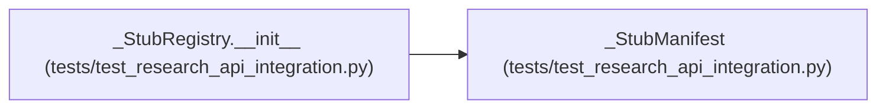

# _StubManifest

**Location:** `tests/test_research_api_integration.py:210`
**Kind:** Class
**Bases:** —
**Module:** [test_research_api_integration](../modules/test_research_api_integration.md)

## Description

_Auto-generated from `_StubManifest` in `tests/test_research_api_integration.py`._

## Attributes

*No annotated attributes found.*

## Methods

| Method | Signature | Decorators | Description |
|--------|-----------|------------|-------------|
| `__init__` | `(kind: str) -> None` | — | — |

## Relationships

<!-- Auto-generated relationship summary. Do not edit by hand. -->

### Summary

| Module | Methods | Attributes |
|---|---:|---|
| [test_research_api_integration](../modules/test_research_api_integration.md) | 1 | — |

### References

| Reference | Kind | Source | Call sites |
|---|---|---|---:|
| `_StubRegistry.__init__` | call | [test_research_api_integration](../modules/test_research_api_integration.md) | 1 |
