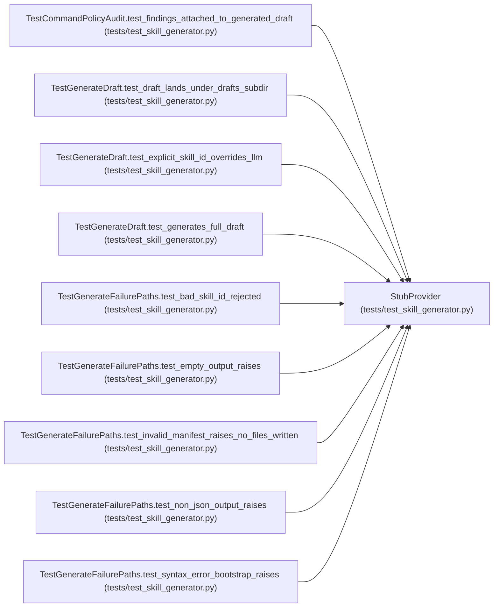

# StubProvider

**Location:** `tests/test_skill_generator.py:43`
**Kind:** Class
**Bases:** —
**Module:** [test_skill_generator](../modules/test_skill_generator.md)

## Description

Deterministic stand-in for ``LLMProvider.complete``.

## Attributes

*No annotated attributes found.*

## Methods

| Method | Signature | Decorators | Description |
|--------|-----------|------------|-------------|
| `__init__` | `(response: str) -> None` | — | — |
| `complete` | *(async)* `(*, model: str, prompt: str, system: str \| None = None, max_tokens: int = 8192) -> str` | — | — |

## Relationships

<!-- Auto-generated relationship summary. Do not edit by hand. -->

### Summary

| Module | Methods | Attributes |
|---|---:|---|
| [test_skill_generator](../modules/test_skill_generator.md) | 2 | — |

### References

| Reference | Kind | Source | Call sites |
|---|---|---|---:|
| `TestCommandPolicyAudit.test_findings_attached_to_generated_draft` | call | [test_skill_generator](../modules/test_skill_generator.md) | 1 |
| `TestGenerateDraft.test_draft_lands_under_drafts_subdir` | call | [test_skill_generator](../modules/test_skill_generator.md) | 1 |
| `TestGenerateDraft.test_explicit_skill_id_overrides_llm` | call | [test_skill_generator](../modules/test_skill_generator.md) | 1 |
| `TestGenerateDraft.test_generates_full_draft` | call | [test_skill_generator](../modules/test_skill_generator.md) | 1 |
| `TestGenerateFailurePaths.test_bad_skill_id_rejected` | call | [test_skill_generator](../modules/test_skill_generator.md) | 1 |
| `TestGenerateFailurePaths.test_empty_output_raises` | call | [test_skill_generator](../modules/test_skill_generator.md) | 1 |
| `TestGenerateFailurePaths.test_invalid_manifest_raises_no_files_written` | call | [test_skill_generator](../modules/test_skill_generator.md) | 1 |
| `TestGenerateFailurePaths.test_non_json_output_raises` | call | [test_skill_generator](../modules/test_skill_generator.md) | 1 |
| `TestGenerateFailurePaths.test_syntax_error_bootstrap_raises` | call | [test_skill_generator](../modules/test_skill_generator.md) | 1 |
