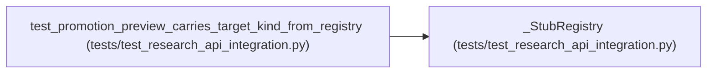

# _StubRegistry

**Location:** `tests/test_research_api_integration.py:224`
**Kind:** Class
**Bases:** —
**Module:** [test_research_api_integration](../modules/test_research_api_integration.md)

## Description

Returns a manifest with a configurable promotion target kind.

## Attributes

*No annotated attributes found.*

## Methods

| Method | Signature | Decorators | Description |
|--------|-----------|------------|-------------|
| `__init__` | `(kind: str) -> None` | — | — |
| `get` | `(skill_id: str)` | — | — |

## Relationships

<!-- Auto-generated relationship summary. Do not edit by hand. -->

### Summary

| Module | Methods | Attributes |
|---|---:|---|
| [test_research_api_integration](../modules/test_research_api_integration.md) | 2 | — |

### References

| Reference | Kind | Source | Call sites |
|---|---|---|---:|
| `test_promotion_preview_carries_target_kind_from_registry` | call | [test_research_api_integration](../modules/test_research_api_integration.md) | 1 |
