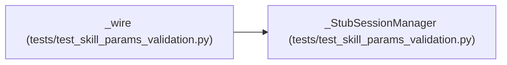

# _StubSessionManager

**Location:** `tests/test_skill_params_validation.py:44`
**Kind:** Class
**Bases:** —
**Module:** [test_skill_params_validation](../modules/test_skill_params_validation.md)

## Description

Records every start attempt so tests can assert side effects never began.

## Attributes

| Name | Type | Default | Description |
|------|------|---------|-------------|
| `_active_pipelines` | `dict[str, object]` | `{}` | — |

## Methods

| Method | Signature | Decorators | Description |
|--------|-----------|------------|-------------|
| `__init__` | `() -> None` | — | — |
| `start_session` | *(async)* `(**kwargs: Any) -> Dict[str, Any]` | — | — |

## Relationships

<!-- Auto-generated relationship summary. Do not edit by hand. -->

### Summary

| Module | Methods | Attributes |
|---|---:|---|
| [test_skill_params_validation](../modules/test_skill_params_validation.md) | 2 | `_active_pipelines` |

### References

| Reference | Kind | Source | Call sites |
|---|---|---|---:|
| `_wire` | call | [test_skill_params_validation](../modules/test_skill_params_validation.md) | 1 |
