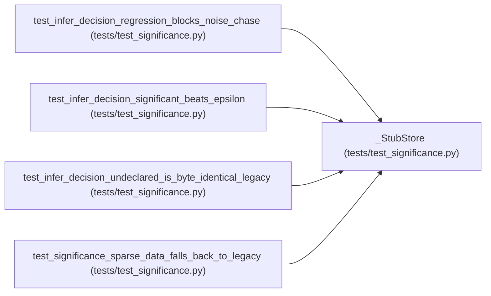

# _StubStore

**Location:** `tests/test_significance.py:199`
**Kind:** Class
**Bases:** —
**Module:** [test_significance](../modules/test_significance.md)

## Description

_Auto-generated from `_StubStore` in `tests/test_significance.py`._

## Attributes

*No annotated attributes found.*

## Methods

| Method | Signature | Decorators | Description |
|--------|-----------|------------|-------------|
| `__init__` | `(best_metric: Optional[float], rows: list[dict]) -> None` | — | — |
| `get_session` | *(async)* `(research_id: str) -> Optional[dict]` | — | — |
| `get_iterations` | *(async)* `(research_id: str) -> list[dict]` | — | — |

## Relationships

<!-- Auto-generated relationship summary. Do not edit by hand. -->

### Summary

| Module | Methods | Attributes |
|---|---:|---|
| [test_significance](../modules/test_significance.md) | 3 | — |

### References

| Reference | Kind | Source | Call sites |
|---|---|---|---:|
| `test_infer_decision_regression_blocks_noise_chase` | call | [test_significance](../modules/test_significance.md) | 1 |
| `test_infer_decision_significant_beats_epsilon` | call | [test_significance](../modules/test_significance.md) | 2 |
| `test_infer_decision_undeclared_is_byte_identical_legacy` | call | [test_significance](../modules/test_significance.md) | 1 |
| `test_significance_sparse_data_falls_back_to_legacy` | call | [test_significance](../modules/test_significance.md) | 1 |
