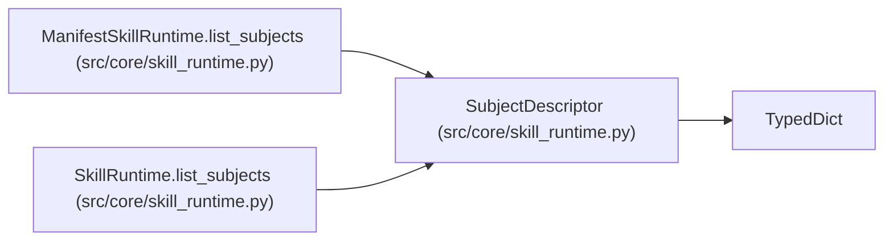

# SubjectDescriptor

**Location:** `src/core/skill_runtime.py:172`
**Kind:** Class
**Bases:** `TypedDict`
**Module:** [skill_runtime](../modules/skill_runtime.md)

## Description

A research subject a skill can enumerate (e.g. an instrument, a model
family). No subject/variant domain exists for the ML skills today — the
transitional runtimes return ``[]`` (greenfield, Phase 2+).

## Attributes

| Name | Type | Presence | Description |
|------|------|----------|-------------|
| `id` | `str` | *optional* | — |
| `label` | `str` | *optional* | — |

## Methods

*No public methods. Inherits from base classes.*

## Relationships

<!-- Auto-generated relationship summary. Do not edit by hand. -->

### Summary

| Module | Methods | Attributes |
|---|---:|---|
| [skill_runtime](../modules/skill_runtime.md) | 0 | `id`, `label` |

### Structure

| Kind | Entity | Module |
|---|---|---|
| Base | `TypedDict` | — |

### References

| Reference | Kind | Source | Call sites |
|---|---|---|---:|
| `ManifestSkillRuntime.list_subjects` | type_reference | [skill_runtime](../modules/skill_runtime.md) | — |
| `SkillRuntime.list_subjects` | type_reference | [skill_runtime](../modules/skill_runtime.md) | — |
