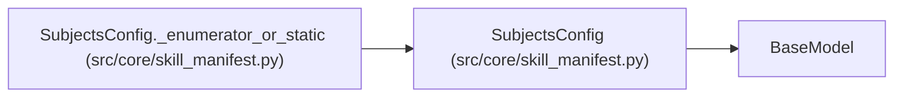

# SubjectsConfig

**Location:** `src/core/skill_manifest.py:156`
**Kind:** Pydantic model
**Bases:** `BaseModel`
**Module:** [skill_manifest](../modules/skill_manifest.md)

## Description

Subject enumeration (G12). ML skills glob config files today; non-ML
skills use an enumerator script or an inline static list. ``static`` accepts
either a list of ``{id, label}`` mappings (rich form) or a list of bare
strings (id-only form, e.g. ``[postgres16, postgres15]``).

## Model Configuration

| Setting | Value | Source |
|---------|-------|--------|
| `extra` | `'forbid'` | model_config |

## Validators

| Method | Scope | Fields | Mode | Options |
|--------|-------|--------|------|---------|
| `_coerce_static_strings` | model | — | before | — |
| `_enumerator_or_static` | model | — | after | — |

## Attributes

| Name | Type | Wire name | Required | Nullable | Default | Constraints | Examples | Description |
|------|------|-----------|----------|----------|---------|-------------|-------------|----------|
| `enumerator` | `Optional[str]` | `enumerator` | No | Yes | `None` | — | — | Relative path of a script emitting ``[{id, label}]`` JSON. |
| `static` | `Optional[list[SubjectField]]` | `static` | No | Yes | `None` | — | — | Inline subject list (mutually exclusive with ``enumerator``). |
| `cache_ttl_s` | `int` | `cache_ttl_s` | No | No | `60` | ge=0 | — | — |

## Methods

| Method | Signature | Decorators | Description |
|--------|-----------|------------|-------------|
| `_coerce_static_strings` | `(data: Any) -> Any` | `@model_validator(mode='before')`, `@classmethod` | Accept bare-string subjects (``[postgres16, postgres15]``) by lifting |
| `_enumerator_or_static` | `() -> 'SubjectsConfig'` | `@model_validator(mode='after')` | — |

## Relationships

<!-- Auto-generated relationship summary. Do not edit by hand. -->

### Summary

| Module | Methods | Attributes |
|---|---:|---|
| [skill_manifest](../modules/skill_manifest.md) | 2 | `cache_ttl_s`, `enumerator`, `static` |

### Structure

| Kind | Entity | Module |
|---|---|---|
| Base | `BaseModel` | — |

### References

| Reference | Kind | Source | Call sites |
|---|---|---|---:|
| `SubjectsConfig._enumerator_or_static` | type_reference | [skill_manifest](../modules/skill_manifest.md) | — |
