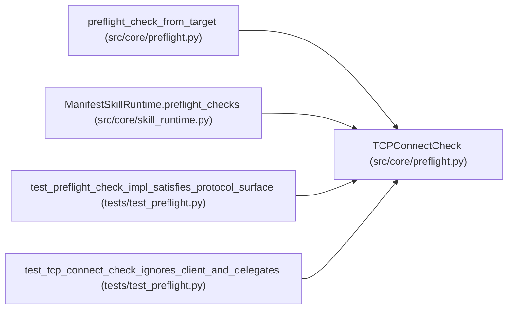

# TCPConnectCheck

**Location:** `src/core/preflight.py:103`
**Kind:** Class
**Bases:** —
**Module:** [preflight](../modules/preflight.md)

## Description

TCP-connect probe (ARC-011 P1-020).

Wraps ``service_preflight._check_tcp_target`` unchanged. Used for generic
skill-declared ``tcp`` targets. Opens its own socket via ``asyncio.open_connection`` —
the ``client`` arg is ignored.

## Attributes

*No annotated attributes found.*

## Methods

| Method | Signature | Decorators | Description |
|--------|-----------|------------|-------------|
| `__init__` | `(target: ServicePreflightTarget, *, timeout_s: float = 3.0) -> None` | — | — |
| `name` | `() -> str` | `@property` | — |
| `required` | `() -> bool` | `@property` | — |
| `check` | *(async)* `(client: httpx.AsyncClient \| None) -> dict[str, Any]` | — | Delegate to ``service_preflight._check_tcp_target`` (behavior-identical). |

## Relationships

<!-- Auto-generated relationship summary. Do not edit by hand. -->

### Summary

| Module | Methods | Attributes |
|---|---:|---|
| [preflight](../modules/preflight.md) | 4 | — |

### References

| Reference | Kind | Source | Call sites |
|---|---|---|---:|
| `preflight_check_from_target` | call | [preflight](../modules/preflight.md) | 1 |
| `ManifestSkillRuntime.preflight_checks` | call | [skill_runtime](../modules/skill_runtime.md) | 1 |
| `test_preflight_check_impl_satisfies_protocol_surface` | type_reference | [test_preflight](../modules/test_preflight.md) | — |
| `test_tcp_connect_check_ignores_client_and_delegates` | call | [test_preflight](../modules/test_preflight.md) | 1 |
