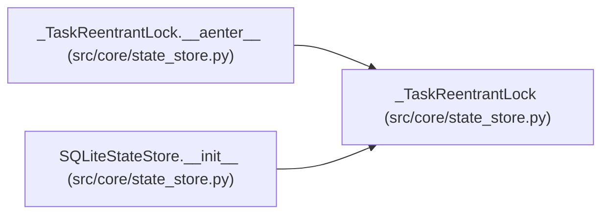

# _TaskReentrantLock

**Location:** `src/core/state_store.py:1673`
**Kind:** Class
**Bases:** —
**Module:** [state_store](../modules/state_store.md)

## Description

An asyncio lock reentrant within one task.

Serializes transaction spans on the shared connection while staying
deadlock-free for same-task nesting (store methods that open a second
connection() while already holding one).

## Attributes

*No annotated attributes found.*

## Methods

| Method | Signature | Decorators | Description |
|--------|-----------|------------|-------------|
| `__init__` | `() -> None` | — | — |
| `__aenter__` | *(async)* `() -> '_TaskReentrantLock'` | — | — |
| `__aexit__` | *(async)* `(*exc: Any) -> None` | — | — |

## Relationships

<!-- Auto-generated relationship summary. Do not edit by hand. -->

### Summary

| Module | Methods | Attributes |
|---|---:|---|
| [state_store](../modules/state_store.md) | 3 | — |

### References

| Reference | Kind | Source | Call sites |
|---|---|---|---:|
| `_TaskReentrantLock.__aenter__` | type_reference | [state_store](../modules/state_store.md) | — |
| `SQLiteStateStore.__init__` | call | [state_store](../modules/state_store.md) | 1 |
