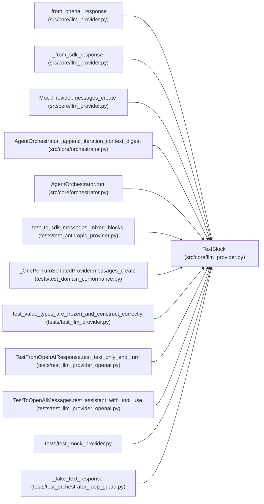

# TextBlock

**Location:** `src/core/llm_provider.py:182`
**Kind:** Class
**Bases:** —
**Module:** [llm_provider](../modules/llm_provider.md)

**Decorators:** `@dataclass(frozen=True)`

## Description

A text content block emitted by the model.

## Attributes

| Name | Type | Default | Description |
|------|------|---------|-------------|
| `text` | `str` | *required* | — |

## Methods

*No public methods. Inherits from base classes.*

## Relationships

<!-- Auto-generated relationship summary. Do not edit by hand. -->

### Summary

| Module | Methods | Attributes |
|---|---:|---|
| [llm_provider](../modules/llm_provider.md) | 0 | `text` |

### References

| Reference | Kind | Source | Call sites |
|---|---|---|---:|
| `_from_openai_response` | call | [llm_provider](../modules/llm_provider.md) | 1 |
| `_from_sdk_response` | call | [llm_provider](../modules/llm_provider.md) | 1 |
| `MockProvider.messages_create` | call | [llm_provider](../modules/llm_provider.md) | 2 |
| `AgentOrchestrator._append_iteration_context_digest` | call | [orchestrator](../modules/orchestrator.md) | 1 |
| `AgentOrchestrator.run` | call | [orchestrator](../modules/orchestrator.md) | 7 |
| `test_to_sdk_messages_mixed_blocks` | call | [test_anthropic_provider](../modules/test_anthropic_provider.md) | 2 |
| `_OnePerTurnScriptedProvider.messages_create` | call | [test_domain_conformance](../modules/test_domain_conformance.md) | 1 |
| `test_value_types_are_frozen_and_construct_correctly` | type_reference | [test_llm_provider](../modules/test_llm_provider.md) | — |
| `TestFromOpenAIResponse.test_text_only_end_turn` | call | [test_llm_provider_openai](../modules/test_llm_provider_openai.md) | 1 |
| `TestToOpenAIMessages.test_assistant_with_tool_use` | call | [test_llm_provider_openai](../modules/test_llm_provider_openai.md) | 1 |
| `test_mock_provider` | import | [test_mock_provider](../modules/test_mock_provider.md) | — |
| `_fake_text_response` | call | [test_orchestrator_loop_guard](../modules/test_orchestrator_loop_guard.md) | 1 |

> References: showing 12 of 15 logical references; 3 omitted by the 12-row generated summary limit.
