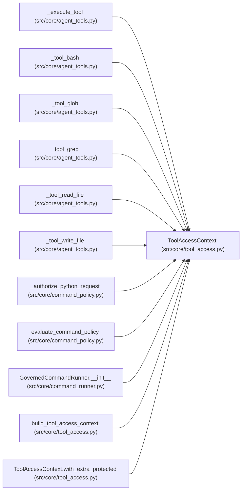

# ToolAccessContext

**Location:** `src/core/tool_access.py:107`
**Kind:** Class
**Bases:** —
**Module:** [tool_access](../modules/tool_access.md)

**Decorators:** `@dataclass(frozen=True)`

## Description

Server-derived file authorization for one run/attempt's tool calls.

Built once per run from the owning session workspace and the skill's
declarations; tool arguments never construct or extend it.

## Attributes

| Name | Type | Default | Description |
|------|------|---------|-------------|
| `session_workspace` | `str` | *required* | — |
| `workspace_root` | `str` | *required* | — |
| `readable_roots` | `tuple[str, ...]` | `field(default_factory=tuple)` | — |
| `writable_roots` | `tuple[str, ...]` | `field(default_factory=tuple)` | — |
| `protected_paths` | `tuple[str, ...]` | `field(default_factory=tuple)` | — |
| `protected_names` | `tuple[str, ...]` | `field(default_factory=tuple)` | — |

## Methods

| Method | Signature | Decorators | Description |
|--------|-----------|------------|-------------|
| `resolve_candidates` | `(raw: str, *, write: bool = False) -> list[str]` | — | Resolve a tool-supplied path to its authorized candidates. |
| `resolve` | `(raw: str) -> str` | — | Resolve ``raw`` to the authorized target path. |
| `_select` | `(raw: str, *, write: bool) -> tuple[Optional[str], str]` | — | Return ``(denial_reason, resolved)`` for one tool-supplied path. |
| `authorize_read` | `(raw: str) -> str` | — | Resolve ``raw`` and require it to land inside a readable root. |
| `authorize_write` | `(raw: str) -> str` | — | Resolve ``raw`` and require an authorized, unprotected target. |
| `authorize_import` | `(raw: str) -> str` | — | Resolve ``raw`` as a copy-in source with strict leaf rules. |
| `writable_root_and_relative` | `(resolved: str) -> tuple[str, str]` | — | Split an authorized write target into ``(root, relative_path)``. |
| `is_write_protected` | `(resolved: str) -> bool` | — | Whether a resolved path is server-owned/evaluation state. |
| `filter_readable` | `(candidates: Iterable[str]) -> list[str]` | — | Keep only candidates that resolve inside a readable root. |
| `with_extra_protected` | `(names: Optional[Iterable[str]]) -> 'ToolAccessContext'` | — | Return a copy with additional protected names merged in. |

## Relationships

<!-- Auto-generated relationship summary. Do not edit by hand. -->

### Summary

| Module | Methods | Attributes |
|---|---:|---|
| [tool_access](../modules/tool_access.md) | 10 | `protected_names`, `protected_paths`, `readable_roots`, `session_workspace`, `workspace_root`, `writable_roots` |

### References

| Reference | Kind | Source | Call sites |
|---|---|---|---:|
| `_execute_tool` | type_reference | [agent_tools](../modules/agent_tools.md) | — |
| `_tool_bash` | type_reference | [agent_tools](../modules/agent_tools.md) | — |
| `_tool_glob` | type_reference | [agent_tools](../modules/agent_tools.md) | — |
| `_tool_grep` | type_reference | [agent_tools](../modules/agent_tools.md) | — |
| `_tool_read_file` | type_reference | [agent_tools](../modules/agent_tools.md) | — |
| `_tool_write_file` | type_reference | [agent_tools](../modules/agent_tools.md) | — |
| `_authorize_python_request` | type_reference | [command_policy](../modules/command_policy.md) | — |
| `evaluate_command_policy` | type_reference | [command_policy](../modules/command_policy.md) | — |
| `GovernedCommandRunner.__init__` | type_reference | [command_runner](../modules/command_runner.md) | — |
| `build_tool_access_context` | call | [tool_access](../modules/tool_access.md) | 1 |
| `build_tool_access_context` | type_reference | [tool_access](../modules/tool_access.md) | — |
| `ToolAccessContext.with_extra_protected` | call | [tool_access](../modules/tool_access.md) | 1 |

> References: showing 12 of 15 logical references; 3 omitted by the 12-row generated summary limit.
