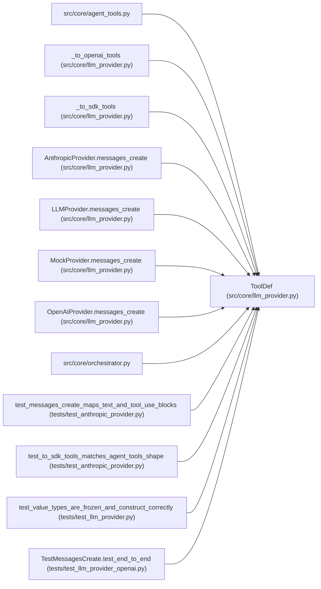

# ToolDef

**Location:** `src/core/llm_provider.py:237`
**Kind:** Class
**Bases:** —
**Module:** [llm_provider](../modules/llm_provider.md)

**Decorators:** `@dataclass(frozen=True)`

## Description

A tool the model may call (matches today's ``AGENT_TOOLS`` entries).

## Attributes

| Name | Type | Default | Description |
|------|------|---------|-------------|
| `name` | `str` | *required* | — |
| `description` | `str` | *required* | — |
| `input_schema` | `dict[str, Any]` | *required* | — |

## Methods

*No public methods. Inherits from base classes.*

## Relationships

<!-- Auto-generated relationship summary. Do not edit by hand. -->

### Summary

| Module | Methods | Attributes |
|---|---:|---|
| [llm_provider](../modules/llm_provider.md) | 0 | `description`, `input_schema`, `name` |

### References

| Reference | Kind | Source | Call sites |
|---|---|---|---:|
| `agent_tools` | import | [agent_tools](../modules/agent_tools.md) | — |
| `_to_openai_tools` | type_reference | [llm_provider](../modules/llm_provider.md) | — |
| `_to_sdk_tools` | type_reference | [llm_provider](../modules/llm_provider.md) | — |
| `AnthropicProvider.messages_create` | type_reference | [llm_provider](../modules/llm_provider.md) | — |
| `LLMProvider.messages_create` | type_reference | [llm_provider](../modules/llm_provider.md) | — |
| `MockProvider.messages_create` | type_reference | [llm_provider](../modules/llm_provider.md) | — |
| `OpenAIProvider.messages_create` | type_reference | [llm_provider](../modules/llm_provider.md) | — |
| `orchestrator` | import | [orchestrator](../modules/orchestrator.md) | — |
| `test_messages_create_maps_text_and_tool_use_blocks` | call | [test_anthropic_provider](../modules/test_anthropic_provider.md) | 1 |
| `test_to_sdk_tools_matches_agent_tools_shape` | call | [test_anthropic_provider](../modules/test_anthropic_provider.md) | 1 |
| `test_value_types_are_frozen_and_construct_correctly` | type_reference | [test_llm_provider](../modules/test_llm_provider.md) | — |
| `TestMessagesCreate.test_end_to_end` | call | [test_llm_provider_openai](../modules/test_llm_provider_openai.md) | 1 |

> References: showing 12 of 13 logical references; 1 omitted by the 12-row generated summary limit.
